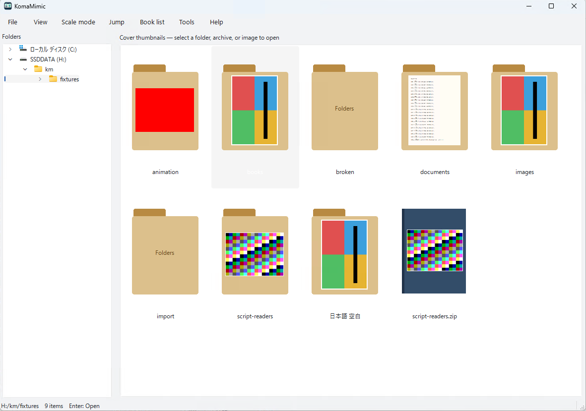

# KomaMimic


KomaMimic is a comic and image viewer for Windows, macOS, and Linux. Browse folders
and archives by their covers, read single pages or spreads, and customize keyboard
and mouse controls. It also reads PDF, plain text, Markdown, and EPUB, and supports
JavaScript image readers and filters through Script API 1.

KomaMimic is an independent implementation inspired by MangaMeeya. It is not
affiliated with the original project and does not include its code, artwork, or DLLs.

## Screenshots

The first screenshot shows the English UI; the second shows the Japanese UI.
The English guide reuses Japanese UI screenshots and labels them on each page.




## Documentation

- [User and script developer guide (English)](https://asfdrwe.github.io/KomaMimic/en/)
- [日本語ユーザ＆スクリプト開発者ガイド](https://asfdrwe.github.io/KomaMimic/)
- [Installation, updates, and removal](docs/site/en/user/install.md)
- [Core developer documentation (English)](docs/developer/index.md)
- [Contributing](#contributing)

The user and script developer guide is available in Japanese and English, with
links between matching pages. Core developer documentation is maintained in English.

## Build from source

Run the commands from the repository root. KomaMimic requires C++20, CMake 3.22+,
Qt 6.5+ with Qml and WebEngine Widgets, libarchive, ICU, zlib, SDL2 2.0.14+,
Poppler GLib 22.0+, Cairo, and pkg-config. A compatible Qt Image Formats installation
provides additional image formats. Keep the Qt modules and toolchain compatible.

### Linux (Fedora 44)

```sh
sudo dnf install gcc-c++ cmake ninja-build qt6-qtbase-devel qt6-qtdeclarative-devel \
  qt6-qttools-devel qt6-linguist qt6-qttranslations qt6-qtwebengine-devel \
  qt6-qtimageformats libarchive-devel libicu-devel \
  zlib-ng-compat-devel sdl2-compat-devel poppler-glib-devel pkgconf-pkg-config
cmake -S . -B build-linux -G Ninja \
  -DCMAKE_BUILD_TYPE=Release -DBUILD_TESTING=OFF
cmake --build build-linux --parallel 4
build-linux/komamimic
```

Use the equivalent development packages on other distributions. Their runtime
compatibility must be checked separately.


### macOS (Apple Silicon)

Install Xcode Command Line Tools and Homebrew, then run:

```sh
brew install cmake ninja qtbase qtdeclarative qttools qttranslations qtwebengine \
  qtimageformats libarchive icu4c sdl2-compat poppler pkgconf
cmake -S . -B build-macos -G Ninja \
  -DCMAKE_BUILD_TYPE=Release -DBUILD_TESTING=OFF -DCMAKE_OSX_ARCHITECTURES=arm64
cmake --build build-macos --parallel 4
build-macos/komamimic
```

CMake discovers the Homebrew prefixes. No `brew link --force` is required.

### Windows (x64, MSVC)

Use Visual Studio 2022 with Desktop development with C++, CMake 3.22+, Git,
Python 3.10+, and a matching official MSVC Qt SDK. The configuration in
`tools/windows-fast.json` currently selects Qt 6.11.2. The helper below obtains or
verifies that SDK; it does not compile Qt. Other dependencies use the pinned
Release-only vcpkg manifest.

First prepare the SDK in PowerShell:

```powershell
python tools/setup_windows.py --output dev/qt-sdk
$env:KOMAMIMIC_QT_ROOT = (Resolve-Path 'dev/qt-sdk/6.11.2/msvc2022_64').Path
```

Prepare a dedicated vcpkg checkout once:

```powershell
$baseline = (Get-Content cmake/windows-fast/vcpkg.json -Raw | ConvertFrom-Json).'builtin-baseline'
git clone https://github.com/microsoft/vcpkg.git dev/vcpkg-koma
git -C dev/vcpkg-koma checkout --detach $baseline
& dev/vcpkg-koma/bootstrap-vcpkg.bat -disableMetrics
```

Configure and build:

```powershell
$env:VCPKG_ROOT = (Resolve-Path 'dev/vcpkg-koma').Path
cmake --preset windows-fast -B build-windows -DBUILD_TESTING=OFF
cmake --build build-windows --config Release --parallel 4
```

The build output does not include the Qt SDK's runtime DLLs, plugins, or WebEngine
resources. To run the development build, use the same PowerShell session from the
repository root and set the runtime search paths:

```powershell
$env:PATH = "$env:KOMAMIMIC_QT_ROOT/bin;$((Resolve-Path 'build-windows/vcpkg_installed/x64-windows-release/bin').Path);$env:PATH"
$env:QT_PLUGIN_PATH = "$env:KOMAMIMIC_QT_ROOT/plugins"
& ./build-windows/Release/komamimic.exe
```

These settings apply to that PowerShell process and programs started from it.
Double-clicking the executable in Explorer does not inherit them.

For a local validation folder that can be launched from Explorer, run the existing
staging helper from the repository root. Choose a new output directory each time:

```powershell
python tools/stage_validation.py --build-dir build-windows --output ../tmp/stage-windows-01
```

After it succeeds, double-click `../tmp/stage-windows-01/app/komamimic.exe`.
The helper copies the non-Qt dependency DLLs and deploys Qt for both the application
and script worker, including plugins, WebEngine resources, and translations.
This is a local validation build; public release packaging still requires the
[distribution checks](#distribution).

## License

Copyright (C) 2026 KomaMimic contributors.

KomaMimic is licensed under [GNU GPL version 3 only](LICENSE)
(`GPL-3.0-only`), without warranty. Third-party components retain their own terms;
see [third-party notices](#third-party-libraries-and-code) and
[distribution requirements](#distribution).

## Contributing

The source is licensed under GPL-3.0-only. Please read the [license](LICENSE),
[third-party notices](#third-party-libraries-and-code), and
[distribution requirements](#distribution).

Read the [architecture](docs/developer/architecture.md) and
[specification](docs/developer/specification.md), build the affected targets, and
run the [automated tests](docs/developer/testing.md) relevant to your changes.
For bug fixes, add tests that reproduce the problem and verify the fix where
appropriate. In a pull request, describe the conditions that trigger the problem,
the resulting behavior, how you verified the change, and anything left unverified.

Bug reports should include the OS, application version, reproduction steps,
expected and actual results, and file format. Prefer small inputs you created
yourself to reproduce the problem. Do not attach works you cannot share or
personal settings.

## Distribution

KomaMimic's original code and application are licensed under GNU General Public
License version 3 only (SPDX: `GPL-3.0-only`). Copyright (C) 2026 KomaMimic contributors.
The full license is in [LICENSE](LICENSE). Preserve the original copyright,
permission, and disclaimer notices for third-party components, whose provenance
and notices are listed [below](#third-party-libraries-and-code).

### Source distribution

The [source packaging procedure](docs/developer/packaging.md) produces an archive
and hashes of the selected application sources, bundled scripts, translations,
build definitions, tests, and documentation. It excludes the original MangaMeeya
distribution, personal settings and history, private works, and internal material.

### Binary distribution

Record the versions and licenses of the dependencies actually bundled. Provide
the applicable copyright, permission, and disclaimer notices, along with any
required corresponding source, modification patches, and build scripts. Links to
upstream home pages or licenses alone do not fulfill corresponding-source
requirements. Make the GPL text and the source corresponding to the actual build
available alongside the binaries.

Poppler is GPL-licensed. Check the distribution terms of the combined application,
including when linking shared libraries. Preserve the respective terms for Qt,
WebEngine/Chromium, GLib, Cairo, codecs, SQLite, SDL, and other components. For
LGPL-covered libraries, meet the applicable replacement and relinking requirements.
Running `cmake --install` or creating a validation stage does not complete these
distribution steps.

For vcpkg, record the baseline, installed package status, copyright files under
`share`, port patches and scripts, and the corresponding upstream source. For
Homebrew and Fedora, also retain the versions used and their corresponding source.
WebEngine requires third-party notices and any required source in addition to its
helper, resources, and locales.

### Adding third-party code

Record its source, version or content hash, affected files, authors, license, and
changes. The PIC/PIC2 scripts retain the original 0BSD terms and use the combined
SPDX expression `GPL-3.0-only AND 0BSD`. Details and the original notice appear
[below](#picpic2-decoding-derived-from-wuimg).

CI builds and verifies Windows x86_64 ZIP, macOS arm64 app/DMG, and Linux x86_64
AppImage candidates. Downloaded candidates have also been checked on their target
operating systems. The [Release workflow](docs/developer/releasing.md) rebuilds and
verifies all packages for stable `vMAJOR.MINOR.PATCH` tags, then publishes a complete
GitHub Release with one application source archive and checksums. Manual Release
workflow runs assemble the same files without publishing. Complete the final
dependency-notice and corresponding-source review before tagging a public release.

## Third-party libraries and code

KomaMimic is [GPL-3.0-only](LICENSE). Dependencies and adapted code retain their
original terms; see the [distribution requirements](#distribution). This is an
overview of dependencies; consult the package's build manifest and bundled notices
for the versions and components actually included.

| Component | Purpose and licensing references |
|---|---|
| Qt Core/Gui/Widgets/Concurrent/Network/PrintSupport/Sql/Qml, optional DBus | UI, images, JavaScript, and other features. [Qt licensing](https://doc.qt.io/qt-6/licensing.html) and each module's notices. |
| Qt WebEngine/Chromium | Document display. [WebEngine licensing](https://doc.qt.io/qt-6/qtwebengine-licensing.html) and third-party notices. |
| Qt Image Formats and codecs | Additional image formats. [Module documentation](https://doc.qt.io/qt-6/qtimageformats-index.html). |
| libarchive | Archives. [Source and license](https://libarchive.org/). |
| ICU | Character conversion. [Source and license](https://github.com/unicode-org/icu). |
| zlib API/zlib-ng compatibility | CRC and related operations. [zlib](https://zlib.net/), [zlib-ng](https://github.com/zlib-ng/zlib-ng). |
| SDL2/sdl2-compat/SDL3 | Gamepads and WAV audio. [SDL](https://github.com/libsdl-org/SDL), [compatibility layer](https://github.com/libsdl-org/sdl2-compat). |
| SQLite/Qt Sql driver | Reading history and other stored data. [SQLite notice](https://sqlite.org/copyright.html) and Qt plugin terms. |
| Poppler GLib/Cairo/GLib/GObject | PDF. [Poppler](https://poppler.freedesktop.org/), [Cairo](https://www.cairographics.org/), [GLib](https://gitlab.gnome.org/GNOME/glib). |

Adding image plugins changes the dependencies and applicable terms. Collect
notices and corresponding source for the actual distribution rather than assuming
that every optional codec is bundled. KomaMimic does not embed UnRAR or external
7z/lha/unrar executables. OS power APIs use system components such as Kernel32 and
IOKit/CoreFoundation; SDKs and OS binaries are not included.

### PIC/PIC2 decoding derived from wuimg

The [legacy PIC reader](scripts/readers/pic/decode.js) adapts wuimg's PIC header
profiles, color cache, and run/chain decoding from
[wuimg pic.c](https://github.com/kaleicon/wuimg/blob/trunk/src/lib/pic.c), with
`SPDX-FileCopyrightText: 2022 kaleido` and `SPDX-License-Identifier: 0BSD`.
The C implementation was converted to JavaScript/TypedArray, with added bounds
checks, RGBA output, and rejection of unsupported modes.

The arithmetic decoding portion of the [PIC2 reader](scripts/readers/pic2/decode.js)
comes from [wuimg pic2.c](https://github.com/kaleicon/wuimg/blob/trunk/src/lib/pic2.c),
whose original notices are `SPDX-FileCopyrightText: 2024 kaleido` and
`SPDX-License-Identifier: 0BSD`. The adaptation adjusts byte/chain bounds,
channel clamping, GRB cache keys, arithmetic split lower bounds, and related details.
The raw/P2SF reader and application integration are original KomaMimic code.
Neither XV nor wuimg itself is linked or bundled.

The upstream commit could not be obtained, so the normalized SHA-256 of the source
snapshot and the normalization method are recorded in the
[PIC provenance record](scripts/readers/pic/upstream.json) and
[PIC2 provenance record](scripts/readers/pic2/upstream.json). The combined SPDX
expression is `GPL-3.0-only AND 0BSD`; the original permission and disclaimer
notices are also preserved in the scripts.

Original [0BSD license](https://raw.githubusercontent.com/kaleicon/wuimg/trunk/LICENSE):

```text
Copyright (C) 2018 by kaleido <https://codeberg.org/kaleido>

Permission to use, copy, modify, and/or distribute this software for any purpose with or without fee is hereby granted.

THE SOFTWARE IS PROVIDED "AS IS" AND THE AUTHOR DISCLAIMS ALL WARRANTIES WITH REGARD TO THIS SOFTWARE INCLUDING ALL IMPLIED WARRANTIES OF MERCHANTABILITY AND FITNESS. IN NO EVENT SHALL THE AUTHOR BE LIABLE FOR ANY SPECIAL, DIRECT, INDIRECT, OR CONSEQUENTIAL DAMAGES OR ANY DAMAGES WHATSOEVER RESULTING FROM LOSS OF USE, DATA OR PROFITS, WHETHER IN AN ACTION OF CONTRACT, NEGLIGENCE OR OTHER TORTIOUS ACTION, ARISING OUT OF OR IN CONNECTION WITH THE USE OR PERFORMANCE OF THIS SOFTWARE.
```

## KomaMimic contributors

- GPT Sol & Astra
- asfdrwe <asfdrwe@gmail.com>

## Changelog

- **v1.1.0**: Add an independent two-pane folder browser, optional reading filenames and thumbnail numbering, and detailed custom thumbnail layouts; simplify the toolbar toggle. Persist shared file-sort defaults, support illustrated Aozora TXT, fix document-layout restoration and folder-tree selection, and reuse cached thumbnails during writer contention.
- **v1.0.3**: Fix Linux AppImage document startup and Windows EPUB Unicode paths; add document deployment checks and cache diagnostics.
- **v1.0.0 — Initial release**
