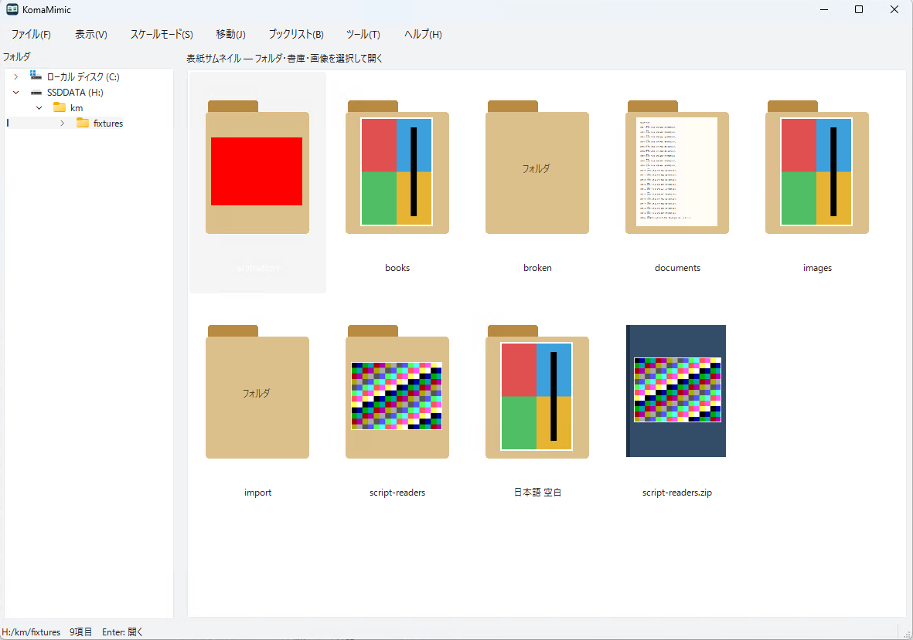

# KomaMimic v2 Guide (development)

v2 is the latest development series, preparing for the v2.0.0 release. This guide is built for `/v2/`.

[日本語](../index.md) | English

Screenshots on this page show the Japanese UI.

KomaMimic is a comic and image viewer for Windows, macOS, and Linux. Choose folders
and archives from a cover list and read single pages, spreads, or full screen.
It also supports PDF, TXT, Markdown, EPUB, and JavaScript image readers and filters.
KomaMimic is an independent implementation inspired by MangaMeeya; v2 extends
its image and document viewing features with local video playback.

v1 continues as the maintained image and document viewer series without video
playback. The [v1 English guide](https://asfdrwe.github.io/KomaMimic/en/)
remains at its existing URL.

## Using KomaMimic

- [Playing videos](user/video.md): local video controls and preferences.

- [Installation](user/install.md): install KomaMimic.
- [Basic controls](user/basic.md): opening, navigation, lists, full screen, keyboard, and mouse.
- [Display and image processing](user/views.md): spreads, zoom, the bottom toolbar, processing, and saving.
- [Reading documents](user/documents.md): TXT, Markdown, EPUB, display settings, and reading positions.
- [Bookshelves, history, and bookmarks](user/library.md): registering books, resuming, sorting, and playback.
- [Settings, reading data, and caches](user/settings.md): storage locations, backups, and capacity.
- [Supported formats and limitations](user/formats.md)
- [Importing MangaMeeya settings](user/migration.md)
- [macOS differences](user/macos.md)

## Scripts

- [Installing and registering scripts](scripts/index.md)
- [API 1 specification](scripts/api.md)
- [Working minimal examples](scripts/examples.md)
- [Bundled readers and filters](scripts/bundled.md)

## Development repository

- [GitHub](https://github.com/asfdrwe/KomaMimic)

## Changelog

- [Changelog](changelog.md)
