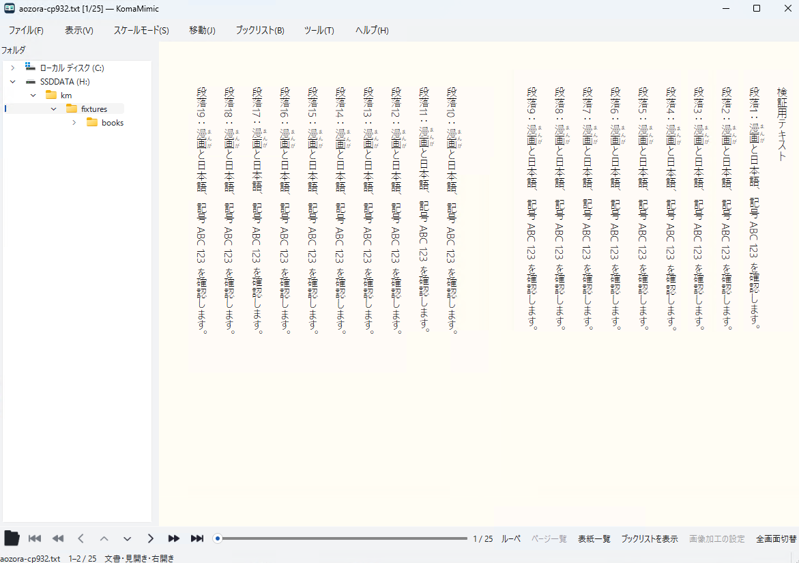
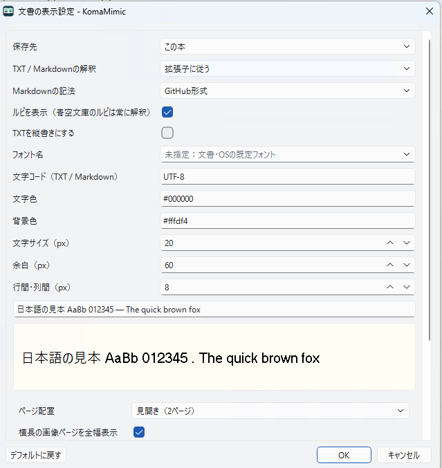

# Reading TXT, Markdown, and EPUB

[日本語](../../user/documents.md) | English

Screenshots on this page show the Japanese UI.

These formats share a document view, including Aozora Bunko ruby annotations in TXT.
If an archive contains TXT/Markdown, choose a document from its internal list.
An image-only archive opens directly in image-reading mode.

## Display settings

Use View → Document → Document display settings… to choose font, font size, line
spacing, colors, vertical/horizontal writing, and page layout. Settings can be saved
per book, per format, or globally. Per-book values take priority; unspecified values
fall back to per-format and then global settings. A blank font name uses the
document/OS default.

Switch single-page/spread display in the settings dialog's page layout or with
`Space`. Space changes are saved for that book and do not change image spread
defaults. By default, landscape image-only pages fit across the full width without
splitting.

Reading positions are saved as positions in the text, restoring a nearby position
after font-size or window-size changes. View → Document also provides the table of
contents, search, font size, and writing direction.

## Overriding keys

Enable document key settings in shortcut settings to choose between using the
common key, assigning a separate key, or leaving an action unassigned. Image keys
are not overwritten. Changing text size and zooming images are separate actions.

## Limitations

Fonts and font sizes cannot be changed in fixed layouts or text embedded in images.
DRM-encrypted text/images cannot be read. Book JavaScript is not executed, and
external sites or images outside the document's scope are not fetched automatically.
Document page thumbnails, image processing, page editing, raster export, and
printing are not supported.
