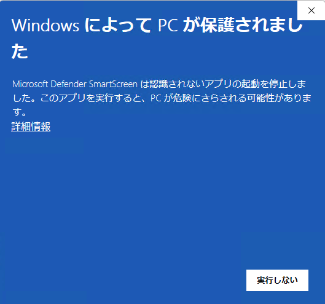
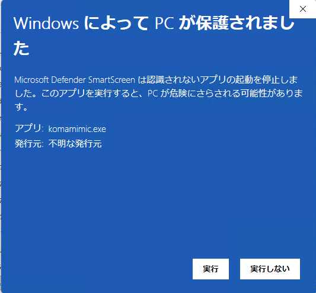

# Installation

[日本語](../../user/install.md) | English

Screenshots on this page show the Japanese UI.

## Windows (ZIP)

The Windows ZIP is for x86_64 (64-bit Intel/AMD). Bundled Qt 6.11 supports Windows
10 (1809 or later) and Windows 11; see the
[Qt support table](https://doc.qt.io/qt-6.11/supported-platforms.html#windows).
Major libraries, including Qt, are bundled. Qt SDK, Visual Studio, and vcpkg are
not required.

### Required runtime

**Microsoft Visual C++ v14 x64 Redistributable** is required. If it is missing or
outdated, obtain the latest X64 package from Microsoft's
[official download instructions](https://learn.microsoft.com/en-us/cpp/windows/latest-supported-vc-redist)
and follow the installer. This runtime is not included in the application ZIP.

If an error reports missing `VCRUNTIME140.dll` or `MSVCP140.dll`, also check that
this runtime is installed and up to date.

### Download and checksum

Download `KomaMimic-1.0.0-windows-x86_64.zip` from
[GitHub Releases](https://github.com/asfdrwe/KomaMimic/releases). These filenames use
v1.0.0 as an example; substitute the downloaded name for other versions.

#### Verifying the package

To check the package, open PowerShell in the folder containing the distribution
ZIP and `SHA256SUMS`, then run:

```powershell
Get-FileHash -LiteralPath .\KomaMimic-1.0.0-windows-x86_64.zip -Algorithm SHA256
```

Compare the displayed `Hash` with the first 64 characters on the line for that ZIP
in `SHA256SUMS`. Letter case does not matter.

### Extraction and startup

Right-click `KomaMimic-1.0.0-windows-x86_64.zip` and choose **Extract All**. Place the
extracted `KomaMimic-1.0.0-windows-x86_64` folder in a writable location. For example,
open `%LOCALAPPDATA%` in Explorer and place it inside `Programs` (create that folder
if needed). The executable is then:

```text
%LOCALAPPDATA%\Programs\KomaMimic-1.0.0-windows-x86_64\komamimic.exe
```

Double-click `komamimic.exe`. Keep the whole folder: its worker, DLLs, and
subfolders are required. Run from the extracted folder, not directly inside the
ZIP. Any shortcut should target this `komamimic.exe`. See [basic controls](basic.md)
after startup.

#### SmartScreen warning

The current Windows build is not code-signed. On first launch of the downloaded
app, Microsoft Defender SmartScreen may display **Windows protected your PC**.

If you downloaded the package from the official Releases page, verified the
checksum above, and choose to launch it, follow these steps. The screenshots show
the Japanese Windows UI.

1. Select **More info** (**詳細情報**) in the warning dialog.

    

2. Check that the app is `komamimic.exe`, then select **Run anyway** (**実行**).
   This version displays **Unknown publisher** (**不明な発行元**) as its publisher.

    

See [Microsoft's SmartScreen explanation](https://learn.microsoft.com/windows/apps/package-and-deploy/smartscreen-reputation)
for how the warning works.

### Updating

1. Quit KomaMimic and [back up the settings folder](settings.md).
2. Download the new distribution ZIP and verify its checksum.
3. Extract the complete package into a new, separate folder and run its `komamimic.exe`.
4. Update any shortcuts to point to the new executable.
5. After checking the new version, remove the old extracted folder if no longer needed.

Normal settings, bookshelves, and history are stored separately from the executable
and carry over when run as the same user. If you used another settings file through
`--config`, continue specifying that file after updating.

### Removal

Quit KomaMimic, delete its extracted folder, and remove shortcuts you created.
Settings, bookshelves, history, and caches remain.

To remove those too, check their [storage locations](settings.md), back up anything
you need, and delete the relevant folders. Bookshelves, history, and reading
positions will be lost. The default settings folder is
`%LOCALAPPDATA%\KomaMimic\KomaMimic`. Your images, archives, and other book files
are separate from application removal. Other applications may use the Visual C++
runtime, so there is no need to uninstall it when removing KomaMimic.

## macOS (DMG)

The macOS version requires an Apple Silicon (arm64) Mac running macOS 15 or later.
Major libraries, including Qt, are bundled; Homebrew and Qt SDK are not required.
There is no Developer ID signature or Apple notarization, so the initial launch
requires the permission steps below.

### Download and checksum

Download `KomaMimic-1.0.0-macos-arm64.dmg` from
[GitHub Releases](https://github.com/asfdrwe/KomaMimic/releases). These filenames use
v1.0.0 as an example; substitute the downloaded name for other versions.

To check the checksum, open Terminal in the folder containing the DMG and run:

```sh
shasum -a 256 KomaMimic-1.0.0-macos-arm64.dmg
```

Compare the first 64 characters with the line for the same DMG in the distributed
`SHA256SUMS`.

### Placement and startup

1. Double-click the downloaded DMG to open it.
2. Drag `KomaMimic` to `Applications` in the same window to copy it.
3. Once copying finishes, open Applications in Finder and double-click `KomaMimic`.
   If Spotlight does not find it, launch it from Finder's Applications folder.


Launch the copied `KomaMimic.app` rather than using the app inside the DMG. You can
eject the DMG from the Finder sidebar after copying.

### Allowing the first launch through Gatekeeper

macOS Gatekeeper blocks the initial launch of the app copied from the downloaded
DMG. Allow this specific app with these steps. Wording can vary by macOS version;
the screenshots show the Japanese interface.

1. When the warning says KomaMimic was not opened, choose **Done** to dismiss it.

    

2. Open System Settings → Privacy & Security and scroll down. Next to the notice
   that KomaMimic was blocked, choose **Open Anyway**.

    

3. Choose **Open Anyway** again in the confirmation asking whether to open KomaMimic.

    

4. If prompted, enter an administrator name and password and choose **OK**. KomaMimic starts.

    

This permission applies to this app. See Apple's
[Open apps safely on your Mac](https://support.apple.com/en-ie/102445) for details.
After startup, see [basic controls](basic.md) and [macOS differences](macos.md).

### Updating

1. Quit KomaMimic from its application menu or with Command+Q.
2. [Back up the settings folder](settings.md), download the new DMG, and verify its checksum.
3. Open the DMG and copy `KomaMimic.app` to Applications, replacing the existing app when prompted.
4. Launch from Finder's Applications folder. If Gatekeeper asks again, use the same permission steps above.
5. After checking the new version, eject the DMG. Delete downloaded DMGs you no longer need.

Normal settings, bookshelves, and history are stored separately from the app and
carry over for the same user. If you used another settings file through `--config`,
continue specifying it after updating.

### Removal

Quit KomaMimic and move `KomaMimic.app` from Finder's Applications folder to the Trash.
You can also remove Dock items you added and downloaded DMGs you no longer need.
Settings, bookshelves, history, and caches remain.

To remove those too, check their [storage locations](settings.md), back up anything
you need, then delete the relevant folders. Bookshelves, history, and reading
positions will be lost. The default settings folder is
`~/Library/Preferences/KomaMimic/KomaMimic`; the thumbnail cache is
`~/Library/Caches/KomaMimic/KomaMimic/thumbnails-v1`. In Finder, use Go → Go to Folder
to enter these paths. Your images, archives, and other book files are separate
from application removal.

## Linux (AppImage)

The Linux AppImage is for x86_64 (amd64). Major libraries, including Qt, are bundled,
so development packages needed to build from source are unnecessary. Place the
AppImage wherever you prefer and launch it.

Automated checks use an Ubuntu 22.04-equivalent baseline (glibc 2.35) or later.
Startup and basic operation have also been checked on Fedora 44.

### Download and extraction

Download the Linux AppImage from [GitHub Releases](https://github.com/asfdrwe/KomaMimic/releases).
Download `KomaMimic-1.0.0-linux-x86_64.zip` and extract it.

The executable is `KomaMimic-1.0.0-linux-x86_64.AppImage`. The adjacent `sources/`
contains source files; you do not need to extract or build them to run the app.
`komamimic.desktop` and `komamimic.png` register the app in the application menu.
The filenames below use v1.0.0 as an example; substitute the downloaded names for
other versions.

If `SHA256SUMS` is included, open a terminal in the extracted ZIP folder and verify
integrity:

```sh
sha256sum --check SHA256SUMS
```

### Placement and startup

This example uses `.local/bin/` in your home folder. Open a terminal in the folder
containing the AppImage and run:

```sh
mkdir -p "$HOME/.local/bin"
mv KomaMimic-1.0.0-linux-x86_64.AppImage "$HOME/.local/bin/"
chmod u+x "$HOME/.local/bin/KomaMimic-1.0.0-linux-x86_64.AppImage"
"$HOME/.local/bin/KomaMimic-1.0.0-linux-x86_64.AppImage"
```

To launch from a file manager, first allow execution in the file's properties.
Then double-click the AppImage or choose the file manager's Run action. Names and
double-click behavior vary by desktop environment.

See [basic controls](basic.md) after startup.

### Application menu registration (optional)

If the AppImage is placed in `~/.local/bin/` as above, copy the bundled files with
the following commands, run from the extracted ZIP folder:

```sh
mkdir -p "$HOME/.local/share/applications" "$HOME/.local/share/icons/hicolor/256x256/apps"
cp komamimic.desktop "$HOME/.local/share/applications/"
cp komamimic.png "$HOME/.local/share/icons/hicolor/256x256/apps/"
```

KomaMimic appears in the menu. If it does not, log out and back in. The bundled
desktop entry starts that version's AppImage from `~/.local/bin/`. For another
location, edit `Exec=` in `komamimic.desktop` to match. Home folder names and opened
filenames may contain spaces or Japanese characters.

### FUSE startup errors

Normal startup uses FUSE. For `Cannot mount AppImage`, `No suitable fusermount binary`,
or similar errors, check your OS's FUSE setup or use extraction-based execution
below. Launching from a terminal shows the error details.

```sh
"$HOME/.local/bin/KomaMimic-1.0.0-linux-x86_64.AppImage" --appimage-extract-and-run
```

This extracts into a temporary folder and runs without FUSE. The temporary location
needs sufficient free space; startup may take longer than normal.

To keep an extracted copy for repeated use, create a new dedicated folder:

```sh
mkdir "$HOME/.local/bin/KomaMimic-1.0.0-extracted"
cd "$HOME/.local/bin/KomaMimic-1.0.0-extracted"
../KomaMimic-1.0.0-linux-x86_64.AppImage --appimage-extract
./squashfs-root/AppRun
```

Afterward, launch `squashfs-root/AppRun` in that folder. Retain the complete extracted
tree. See the [official AppImage FUSE explanation](https://docs.appimage.org/user-guide/troubleshooting/fuse.html).

### Updating

1. Quit KomaMimic.
2. Download the new AppImage and verify its supplied checksum.
3. Place it where you prefer, make it executable, and launch it.
4. If registered in the application menu, also replace `komamimic.desktop` and `komamimic.png` with the new ZIP's copies.
   Update any custom shortcuts to the new target.

Settings, bookshelves, and history are separate from the AppImage and carry over
for the same user. [Back up the settings folder](settings.md) before updating if you
want to preserve the old state. After checking the new version, delete old AppImages
you no longer need. If using manual extraction, extract each new version into a
separate folder and launch it there.

### Removal

Quit KomaMimic, delete the AppImage, and remove shortcuts you created. If manually
extracted, also delete that version's dedicated extraction folder. If you used the
bundled menu-registration files, remove them too:

```sh
rm -f "$HOME/.local/share/applications/komamimic.desktop"
rm -f "$HOME/.local/share/icons/hicolor/256x256/apps/komamimic.png"
```

Deleting the AppImage leaves settings, bookshelves, history, and caches. To remove
those too, check their [storage locations](settings.md), back up anything you need,
then delete the relevant folders. Bookshelves, history, and reading positions will
be lost. Keep the settings folder if you plan to use the app again. Your images,
archives, and other book files are separate from application removal.
