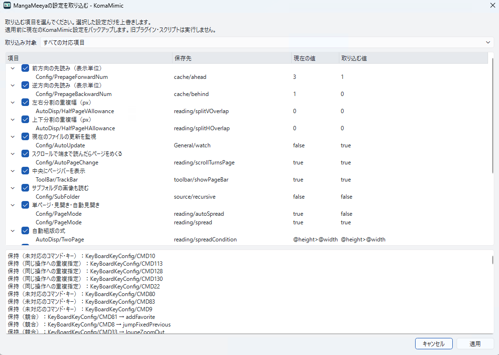

# Importing MangaMeeya settings

[日本語](../../user/migration.md) | English

Screenshots on this page show the Japanese UI.

Select an INI file with File → Import MangaMeeya settings…. The original INI is not
modified; only items with known mappings are converted.

1. Choose all settings, keys only, reading/loading only, preloading only, or reading toolbar only.
2. Review current and imported values, reasons for unsupported/conflicting entries, and select the items to apply.
3. Apply backs up current settings before writing the selected values.
4. Check keys and display behavior. Reopen the book for settings that require reloading.

Cancel imports nothing and creates no backup. The backup is
`KomaMimic-before-MangaMeeya-XXXXXX.ini` in the settings folder. To restore it in
full, quit the app and replace settings.ini with its contents. This is different
from overwriting values through normal settings import.

Main supported items include display mode, preloading, file watching, recursive
loading, automatic spread/split conditions, compatible keys, and bottom-toolbar
layout. Unknown numbers, values, or units are not guessed. Conflicting keys are
not imported; current assignments are preserved.

This operation does not migrate mouse/gamepad settings, plugins, external programs,
paths, or history.
