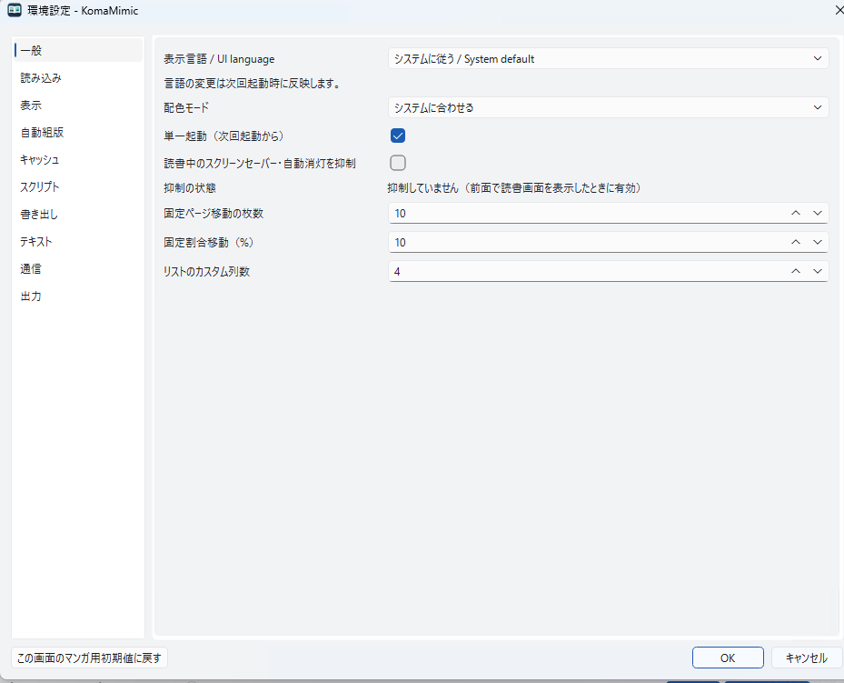
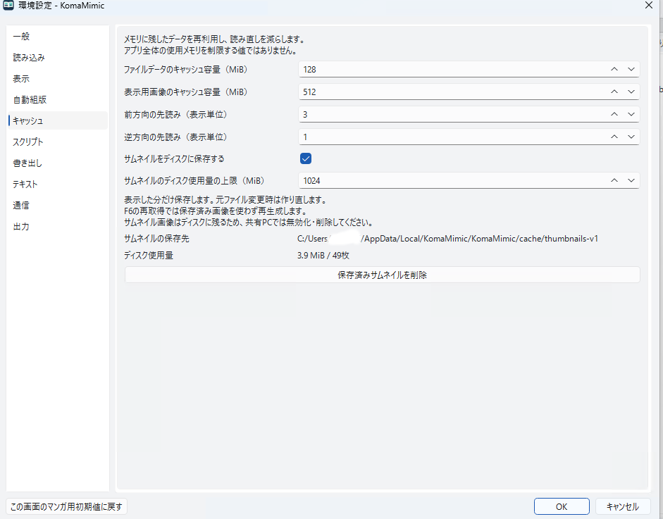

# Settings, reading data, and caches

[日本語](../../user/settings.md) | English

Screenshots on this page show the Japanese UI.

## Settings and reading data

Normal startup stores `settings.ini` in the OS-standard settings location.
`library.sqlite3` in the same folder stores bookshelves, history, reading positions,
and related data.

| OS | Default settings file |
|---|---|
| Windows | `%LOCALAPPDATA%\KomaMimic\KomaMimic\settings.ini` |
| macOS | `~/Library/Preferences/KomaMimic/KomaMimic/settings.ini` |
| Linux | `~/.config/KomaMimic/KomaMimic/settings.ini` |

On Linux, `XDG_CONFIG_HOME` overrides the `~/.config` portion.
Use `--config /path/to/settings.ini` to specify another settings file.
Older layouts may be migrated to a different location at startup.

To back up, quit the app and copy the entire settings folder.

## Fullscreen

Use Preferences → Display → Fullscreen and press OK to change the current window.
Cancel leaves it unchanged. Changes made through menus, shortcuts, or OS window controls are also remembered.
Quitting in fullscreen restores fullscreen on the next startup; leaving fullscreen before quitting restores a normal window instead.
Leaving fullscreen restores the normal window's position, size, and maximized state.

New settings and older settings without a saved fullscreen state start in a normal window.
`--fullscreen` (`-f`) starts in fullscreen regardless of the saved state.
Settings slots and KomaMimic settings export/import include the fullscreen state.
Importing an older file without this setting keeps the current fullscreen state.

## Caches

Preferences → Cache controls in-memory preloading and thumbnail disk storage.
Thumbnail disk storage is enabled by default with a 512 MiB limit and can be cleared
from this dialog. Thumbnails can be regenerated; they do not replace settings or
reading-history backups.

| OS | Default thumbnail cache |
|---|---|
| Windows | `%LOCALAPPDATA%\KomaMimic\KomaMimic\cache\thumbnails-v2` |
| macOS | `~/Library/Caches/KomaMimic/KomaMimic/thumbnails-v2` |
| Linux | `~/.cache/KomaMimic/KomaMimic/thumbnails-v2` |

On Linux, `XDG_CACHE_HOME` overrides `~/.cache`. These paths use
[Qt's OS-specific storage locations](https://doc.qt.io/qt-6/qstandardpaths.html#StandardLocation-enum).
A different `--config` does not change the independent OS-standard cache location.
The memory-cache setting is not a limit on total application memory use.

## Colors and language

Preferences → General lets you choose system/light/dark colors and Japanese,
English, or the system language. Save and restart to apply the UI language.
The color mode does not replace configured document or image colors.

See [Differences from MangaMeeya](compatibility.md) for compatibility and sorting persistence.

## Reuse and regeneration

In v1.5.0, saved thumbnails are trusted by default. They are not checked against their sources on every use or periodically. Redisplay, scrolling, revisiting a folder, or restarting alone does not reopen source images or ZIPs.

| Situation | Priority |
|---|---|
| A visible cover or page has cached pixels | Display them before source checks |
| A visible thumbnail has no cache | Generate and display it; save afterward |
| Relevant change evidence exists | Keep the saved image visible, then check at lower priority |
| Folder, book, or view changes | Cancel unfinished old requests and prioritize the destination |
| Reading | Current display, then prefetch, then saving previously completed thumbnails |

Visible PNG reads run separately from heavy generation, without waiting for writer/maintenance locks or a full cache inventory. Page-thumbnail mode does not render or prefetch the hidden reading image. Reading does not generate or validate thumbnails or scan hidden browser lists.

### Checking changes

Reuse the names, sizes, modification times, and other information already obtained for the current directory listing. Only relevant listing differences, OS notifications, or changes made in the app trigger checks. Unchanged ZIPs are not opened, original images are not decoded, and full content hashes are not calculated just to validate a cache.

Adding files without changing the selected cover source or its attributes does not probe the old source again, regenerate the image, rewrite the PNG, or update its save time. Replace the image only when the selected source or its content needs updating.

Deep changes that the existing format cannot identify, or changes missed by notifications, are not exhaustively tracked. Use `F6` for an explicit refresh when needed. Font or script changes do not automatically invalidate all cached images.

### Folder-cover search depth

Preferences → Thumbnails → additional folder-cover search levels accepts **0–8 and defaults to 0**. When viewing A containing B:

| Value | Search range |
|---|---|
| 0 | Search B's direct images and archives without entering B/C |
| 1 | Also search C's direct files |
| 2 or more | Search up to the configured additional depth, then stop |

Candidates use natural order with files before folders. Sorting the displayed list does not change this selection rule. Show a folder icon if no candidate is found within the limit, without repeatedly searching the same unchanged visible item. Reducing depth or reaching a cutoff does not delete an existing cover.

### Saving, retention, and capacity

Generated pixels are displayed before persistence finishes. Completed images remain pending across folder or view changes and are saved below current-display and reading-prefetch priority. Saving does not recheck the source. Keep the previous PNG until its replacement is saved successfully; temporary generation or write failures do not delete it first.

Pending images spill to disk at the memory limit; contention and write failures are retried. Normal shutdown journals unfinished saves for recovery on the next launch. Journals and atomic-write temporary files need extra space beyond the completed-cache limit. A full or unwritable disk, or an abrupt exit before journaling, can still require regeneration.

Unchanged images are retained regardless of last use, age, file count, scrolling, restart, or display thumbnail size. Only capacity overflow, including a reduced configured limit, triggers **oldest-save-time-first eviction (FIFO)**. Reads never change PNG save times. A changed image receives a new save time after its replacement is saved successfully.

Explicit cache deletion, confirmed source changes or removal, and corruption found while reading the cache can also cause replacement or deletion. Suspected changes alone do not delete an image first.

### Compatibility and text covers

v1.5.0 retains the `thumbnails-v2` location and format. Updating does not require clearing existing v2 images or regenerating the entire cache. Completed **cover previews for TXT, Markdown, and archives containing text are also saved**. Their bodies use document reading, separate from image-page thumbnails.

`thumbnails-v1` is not read, migrated, or automatically deleted. To reclaim its space, use Preferences → Cache in an older version that uses that format. Current cache clearing normally affects only v2 and does not remove source images, archives, bookshelves, or reading history.

Incomplete temporary files left by an abnormal exit are not read as committed PNGs. Qt checks lock ownership and other stale-lock conditions before reclaiming a leftover lock.

### Workaround for incorrect thumbnails

1. In the cover or page-thumbnail view, press `F6` (**Refresh thumbnails** / **サムネイルを再取得**) to regenerate images from their sources. Try this first for stale, incorrect or missing thumbnails.
2. If the problem persists, clear the current thumbnail cache from Preferences → Cache, then reopen the affected folder or archive to regenerate it.
3. If the problem remains, check that the original image or ZIP can be read, disk space and file permissions. Regenerating thumbnails cannot repair a damaged original file.

Clearing the cache does not erase original files, bookshelves or reading history. Regeneration requires time to read the sources.
