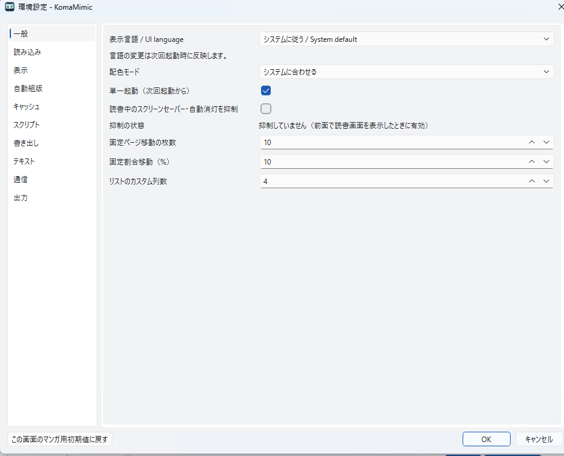
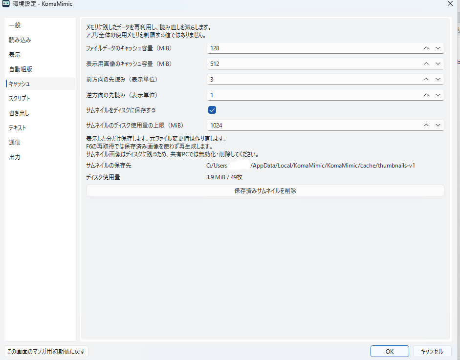

# Settings, reading data, and caches

[日本語](../../user/settings.md) | English

Screenshots on this page show the Japanese UI.

## Settings and reading data

Normal startup stores `settings.ini` in the OS-standard settings location.
`library.sqlite3` in the same folder stores bookshelves, history, reading positions,
and related data.

| OS | Default settings file |
|---|---|
| Windows | `%LOCALAPPDATA%\KomaMimic\KomaMimic\settings.ini` |
| macOS | `~/Library/Preferences/KomaMimic/KomaMimic/settings.ini` |
| Linux | `~/.config/KomaMimic/KomaMimic/settings.ini` |

On Linux, `XDG_CONFIG_HOME` overrides the `~/.config` portion.
Use `--config /path/to/settings.ini` to specify another settings file.
Older layouts may be migrated to a different location at startup.

To back up, quit the app and copy the entire settings folder.

## Autoplay interval

Set Preferences → Display → Automatic playback interval (ms); 1000 ms is one second.
Start forward/reverse playback, pause, or stop from Book list → Page and playlist playback.
This differs from MangaMeeya's dedicated Playlist playback settings dialog.
See [compatibility notes](compatibility.md) and [playback controls](library.md).

## Fullscreen

Use Preferences → Display → Fullscreen and press OK to change the current window.
Cancel leaves it unchanged. Changes made through menus, shortcuts, or OS window controls are also remembered.
Quitting in fullscreen restores fullscreen on the next startup; leaving fullscreen before quitting restores a normal window instead.
Leaving fullscreen restores the normal window's position, size, and maximized state.

New settings and older settings without a saved fullscreen state start in a normal window.
`--fullscreen` (`-f`) starts in fullscreen regardless of the saved state.
Settings slots and KomaMimic settings export/import include the fullscreen state.
Importing an older file without this setting keeps the current fullscreen state.

## Caches

Preferences → Cache controls in-memory preloading and thumbnail disk storage.
Thumbnail disk storage is enabled by default with a 512 MiB limit and can be cleared
from this dialog. Thumbnails can be regenerated; they do not replace settings or
reading-history backups.

Capacity is specified in MiB without a fixed application cap on the manually chosen value; values of 10000 MiB or more can be entered and saved. Changing capacity does not regenerate or rewrite existing thumbnails.

| OS | Default thumbnail cache |
|---|---|
| Windows | `%LOCALAPPDATA%\KomaMimic\KomaMimic\cache\thumbnails-v2` |
| macOS | `~/Library/Caches/KomaMimic/KomaMimic/thumbnails-v2` |
| Linux | `~/.cache/KomaMimic/KomaMimic/thumbnails-v2` |

On Linux, `XDG_CACHE_HOME` overrides `~/.cache`. These paths use
[Qt's OS-specific storage locations](https://doc.qt.io/qt-6/qstandardpaths.html#StandardLocation-enum).
A different `--config` does not change the independent OS-standard cache location.
The memory-cache setting is not a limit on total application memory use.

## Colors and language

Preferences → General lets you choose system/light/dark colors and Japanese,
English, or the system language. Save and restart to apply the UI language.
The color mode does not replace configured document or image colors.

See [Differences from MangaMeeya](compatibility.md) for compatibility and sorting persistence.

## Reuse and regeneration

Use memory first, then saved PNGs. Read the source and generate a thumbnail only when both are missing. Saved thumbnails are trusted by default. They are not checked against their sources on every use or periodically. Redisplay, scrolling, revisiting a folder, or restarting alone does not reopen source images or ZIPs.

| Situation | Priority |
|---|---|
| A visible cover or page has cached pixels | Display them before source checks |
| A visible thumbnail has no cache | Generate and display it; save afterward |
| A folder change notification arrives | Refresh listing metadata; regenerate only images or ZIPs newer than their cache |
| Folder, book, or view changes | Cancel unfinished old requests and prioritize the destination |
| Reading | Current display, then prefetch, then saving previously completed thumbnails |

Visible PNG reads run separately from heavy generation, without waiting for writer/maintenance locks or a full cache inventory. Page-thumbnail mode does not render or prefetch the hidden reading image. Reading does not generate or validate thumbnails or scan hidden browser lists.

### Thumbnail generation concurrency

Preferences → Thumbnails → **Thumbnail generation concurrency** accepts 1–4 jobs. The default is 1 (no parallel generation). Keep 1 to limit disk load; increase it when you want parallel generation.
This controls generation of visible cover and page thumbnails. It does not change cache reading, reading-mode images or prefetch, or explicit bulk operations.
Saving applies the limit to newly started jobs and keeps it across restarts. Changing this setting does not delete, regenerate, or rewrite existing thumbnails.

### Preload all thumbnails

Preferences → Thumbnails → **Preload all thumbnails** is off by default.
When off, only visible items are requested, with a limited number of completed images retained in memory.
When on, the current cover list or current book's page list is loaded progressively after visible cache reads
and missing-thumbnail generation have finished. Missing cached images are generated as needed.
This does not crawl all folders or create document-body page thumbnails.

Scrolling interrupts preloading and gives the new visible range priority. Remaining work resumes after input settles.
Completed display images remain in memory within the limit, avoiding file reads and image decoding on return.
Changing folders, books or display modes cancels remaining work. Preloading does not run in Reader.

**Offscreen thumbnail memory limit (MiB)** defaults to 128 MiB, adjustable from 16 to 2048 MiB.
It bounds offscreen thumbnail images and display icons in the current list, evicting older images when necessary.
Visible images, other existing caches and Qt overhead are separate; this is not a whole-application memory limit.
A list larger than the limit cannot remain entirely in memory at once.
Turning the option off restores normal retention without deleting saved disk thumbnails.
If disk saving is enabled, preloaded offscreen images are also saved for later reuse.

### Load all files

Tools → Load all files is a saved on/off loading option. You can select it in
cover and page thumbnail views, but whole-file loading runs only in Reader.
The current image and configured nearby preloading come first. The option then
retains JPEG, PNG, and other file data in memory; it does not generate thumbnails
or decode every page into pixels.

Navigation cancels in-flight work. Once reading is idle, remaining files can be
loaded while completed data stays reusable for the same book. Turning the option
off releases its retained data. Preferences → Cache → Whole-file loading limit
(MiB) defaults to 128 MiB, separate from the regular encoded-file and pixel caches.
Loading stops at that limit or the final file. Importing MangaMeeya settings maps
`Config/BundleLoad` to this option.

Reader does not prepare hidden page-thumbnail items or their dedicated metadata.
Those are prepared when entering the thumbnail view; obsolete listing work is
cancelled when returning to reading.

### Checking changes

Folder change notifications refresh directory-listing information. Regenerate only when the listed image or ZIP file has a modification time newer than the cached PNG’s save time. Do not open source images or ZIP contents to check for changes. If an update is not identified this way, use `F6` for manual regeneration.

### Folder-cover search depth

Preferences → Thumbnails → additional folder-cover search levels accepts **0–8 and defaults to 0**. When viewing A containing B:

| Value | Search range |
|---|---|
| 0 | Search B's direct images and archives without entering B/C |
| 1 | Also search C's direct files |
| 2 or more | Search up to the configured additional depth, then stop |

Candidates use natural order with files before folders. Sorting the displayed list does not change this selection rule. Show a folder icon if no candidate is found within the limit, without repeatedly searching the same unchanged visible item. Reducing depth or reaching a cutoff does not delete an existing cover.

### Saving, retention, and capacity

Generated pixels are available in memory before saving finishes. Visible thumbnail generation follows the configured concurrency (1–4 jobs, default 1). Each worker saves its completed image directly to the regular cache. Atomic PNG replacement keeps the previous image until its replacement succeeds.

Unchanged images are retained regardless of last use, age, file count, scrolling, restart, or display thumbnail size. Only capacity overflow, including a reduced configured limit, triggers **oldest-save-time-first eviction (FIFO)**. Reads never change PNG save times. A changed image receives a new save time after its replacement is saved successfully.

Explicit cache deletion, F6 refresh, and capacity eviction are exceptions. If a cached PNG cannot be read, try another saved copy before generating from the source.

### Compatibility and text covers

v1.5.0 retains the `thumbnails-v2` location and format. Updating does not require clearing existing v2 images or regenerating the entire cache. Completed **cover previews for TXT, Markdown, and archives containing text are also saved**. Their bodies use document reading, separate from image-page thumbnails.

Decoded thumbnails also share a 32 MiB memory cache. While an image remains there,
revisiting folders or switching views avoids reading and decoding its saved PNG.
Evicted images and images after a restart are loaded from saved PNGs.
This cache is separate from the retention limit for full-list thumbnail preloading.

`thumbnails-v1` is not read, migrated, or automatically deleted. To reclaim its space, use Preferences → Cache in an older version that uses that format. Current cache clearing normally affects only v2 and does not remove source images, archives, bookshelves, or reading history.

Incomplete temporary files left by an abnormal exit are not read as committed PNGs. Qt checks lock ownership and other stale-lock conditions before reclaiming a leftover lock.

### Workaround for incorrect thumbnails

1. In the cover or page-thumbnail view, press `F6` (**Refresh thumbnails** / **サムネイルを再取得**) to regenerate images from their sources. Try this first for stale, incorrect or missing thumbnails.
2. If the problem persists, clear the current thumbnail cache from Preferences → Cache, then reopen the affected folder or archive to regenerate it.
3. If the problem remains, check that the original image or ZIP can be read, disk space and file permissions. Regenerating thumbnails cannot repair a damaged original file.

Clearing the cache does not erase original files, bookshelves or reading history. Regeneration requires time to read the sources.
