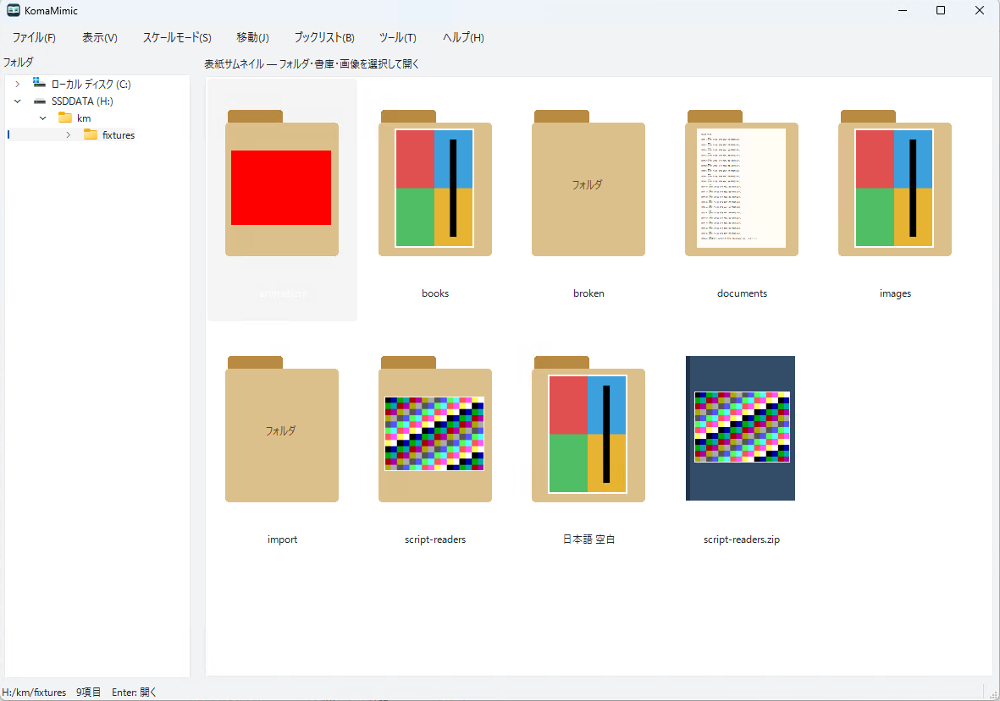

# KomaMimic v2ガイド（開発中）

v2は最新の開発系列で、v2.0.0の正式公開を準備しています。このガイドは`/v2/`で公開する文書です。

日本語 | [English](en/index.md)

KomaMimicはWindows・macOS・Linuxで使える漫画・画像ビューアです。
フォルダや書庫を表紙一覧から選び、単ページ・見開き・全画面で読めます。
PDF・TXT・Markdown・EPUBと、JavaScriptによる画像reader・filterにも対応します。
MangaMeeyaを参考にした独立実装で、v2では画像・文書の閲覧に動画再生を加えています。

動画再生を含まないv1は、画像・文書ビューアの系列としてメンテナンスします。
[v1の日本語ガイド](https://asfdrwe.github.io/KomaMimic/)は従来のURLに維持します。

## 使い方

- [動画を再生する](user/video.md)：ローカル動画の操作・設定。

- [インストール](user/install.md)：KomaMimic のインストール
- [基本操作](user/basic.md)：開く、移動、一覧、全画面、キーとマウス。
- [表示と画像加工](user/views.md)：見開き、倍率、下部バー、加工、保存。
- [文書を読む](user/documents.md)：TXT・Markdown・EPUB、表示設定と読書位置。
- [本棚・履歴・しおり](user/library.md)：本の登録、再開、並び順と再生。
- [設定・読書データ・キャッシュ](user/settings.md)：保存場所、バックアップ、容量。
- [対応形式と制限](user/formats.md)
- [MangaMeeyaの設定を取り込む](user/migration.md)
- [macOSで異なる操作](user/macos.md)

## スクリプト

- [スクリプトの導入と登録](scripts/index.md)
- [API 1仕様](scripts/api.md)
- [動く最小例](scripts/examples.md)
- [同梱readerとfilter](scripts/bundled.md)

## 開発リポジトリ
- [GitHub](https://github.com/asfdrwe/KomaMimic)

## 更新履歴
- [更新履歴](changelog.md)
