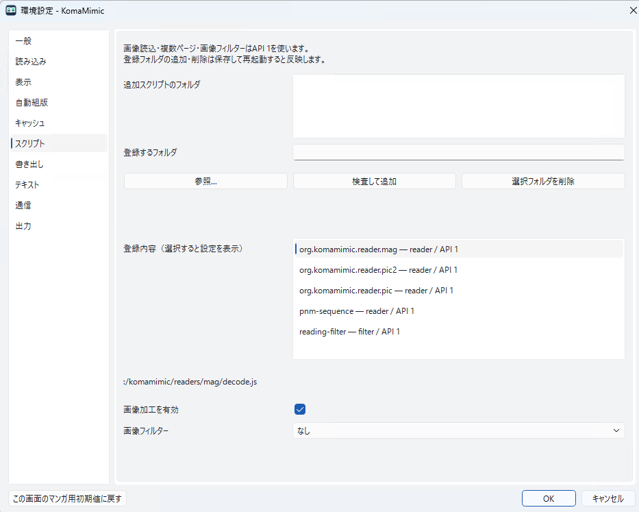

# スクリプトの導入と登録

日本語 | [English](../en/scripts/index.md)

API 1のJavaScriptで画像reader、複数ページreader、画像filterを追加できます。
汎用の文書reader・書庫reader・writer API、Susie/AviSynthの互換実行は提供しません。

## 環境設定で登録する

1. `manifest.json` とJavaScriptを同じpackageフォルダに置きます。
2. 「環境設定 → スクリプト」でpackage、または直下にpackageを並べたフォルダを指定します。
3. 「検査して追加」で内容を検査し、設定値と使うfilterを選びます。
4. OKで保存し、フォルダ追加・削除は再起動で反映します。値の変更後は本を開き直します。



登録の検査ではJavaScriptを実行しません。キャンセルでは登録・設定値・実行中の一覧を
変更しません。登録の削除はファイルの削除ではありません。同じIDは後の登録で置換します。
同梱を含め最大32package、保存する登録フォルダは最大32件です。

起動時に登録先を読めない場合は同梱readerで起動し、設定画面に原因を表示します。
フォルダを修正するか登録解除して再起動してください。
画像・書庫に入っているJavaScriptを自動的に探して実行する機能はありません。

## 開発時の指定

```sh
komamimic --script-readers /path/to/package /path/to/sample.toy
```

複数回指定できます。保存した登録の後に適用する、その起動中だけの上書きで、自動保存しません。
この指定では既存ウィンドウへ転送せず独立して起動します。ソース変更後は再起動が必要です。

[API仕様](api.md)と[最小例](examples.md)へ進んでください。
