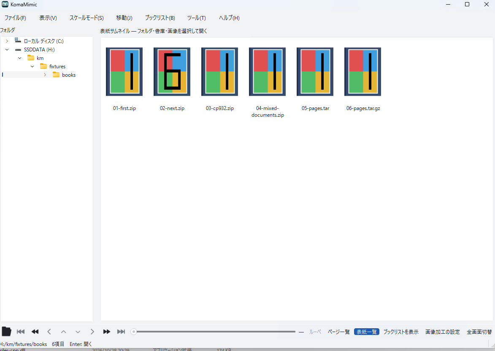
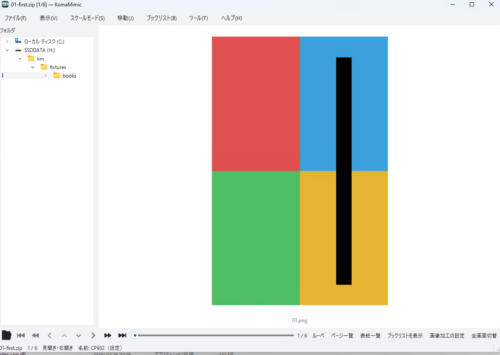
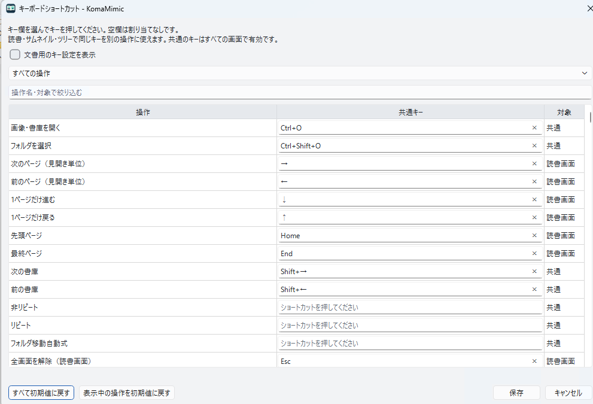

# 基本操作

以下は新しい設定での操作です。変更済みの設定があれば保存した割当を優先します。
macOSは[操作の違い](macos.md)も参照してください。

## 本やフォルダを開く

`Ctrl+O` で画像・書庫・PDF・文書を選び、`Ctrl+Shift+O` でフォルダを開きます。
ウィンドウへのドラッグ＆ドロップでも開けます。表紙一覧ではダブルクリック、
または矢印キーで選択して `Return/Enter` を押すと項目を開きます。
フォルダ内の画像を直接読む操作は `Ctrl+Return` です。

## ページを移動する

| 操作 | 初期キー |
|---|---|
| 次／前の表示 | →／← |
| 見開きを1ページずらす | ↓／↑ |
| 先頭／最終 | Home／End |
| 次／前の書庫 | Shift+→／Shift+← |
| 表紙一覧／上のフォルダ | Shift+↓／Shift+↑ |
| ページサムネイル | Ctrl+E |
| フォルダツリー | Ctrl+T |
| 指定ページ | Ctrl+N |
| 全画面 | Windows/Linux: F11、macOS: Control+Command+F |
| 画面に合わせる／原寸 | X／C |
| 自動見開きの切替 | Space |

開く向きとページ送りキーは別の設定です。右開きでもキーの次／前は上の表に従います。
画像のSpaceは自動見開き、文書のSpaceは本別の単ページ／見開きを切り替えます。
一覧のReturnは選択の決定です。全画面と共用しません。

## マウス

画像の読書中は左クリックで次、右クリックで前へ進みます。ホイールは縦スクロールし、
端でページを送ります。右ボタンを押しながらホイールで拡大縮小します。
中ボタンはルーペ、中ボタンドラッグはパンです。
左／右ダブルクリックで順／逆の自動再生を開始し、同じ方向の操作で停止します。
大きな画像ではスクロールしてから次へ進みます。

表紙・ページサムネイルは、マウスを動かすとその下の項目を選択します。
「環境設定 → 表示 → マウス移動でサムネイルを選択する」で無効にできます。

## 操作を変更する

「ツール → 操作設定 → キーボード」（`Ctrl+K`）でキーを変更します。
共通・読書・サムネイル・ツリーの範囲を選び、検索で操作を絞れます。
マウス・ゲームパッド・下部バーも操作設定から変更できます。
環境設定はWindows/Linuxで `Ctrl+Alt+,`、macOSで `Command+,` です。

最後から先へ進むときの動作は「移動」メニューの非リピート・リピート・
フォルダ移動自動式で選びます。先頭から前へ戻る場合も逆方向に同じ規則です。

