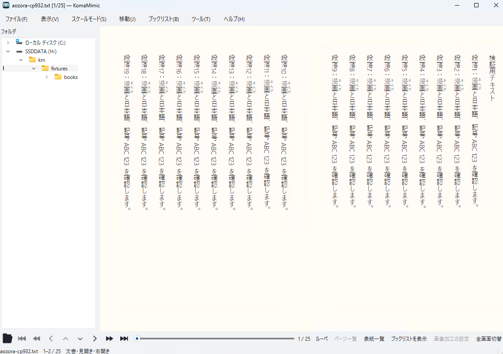
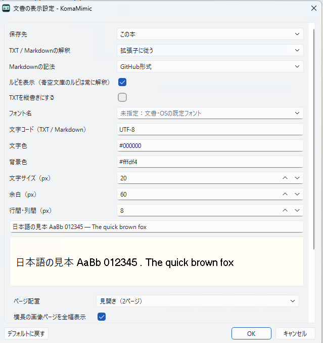

# TXT・Markdown・EPUBを読む

日本語 | [English](../en/user/documents.md)

これらの形式は共通の文書ビューで読みます。TXTの青空文庫ルビにも対応します。
書庫にTXT/Markdownが入っている場合は、書庫内の一覧から文書を選んで開きます。
画像だけの書庫は直接画像の読書画面になります。

## 表示設定

「表示 → 文書 → 文書の表示設定…」でフォント、文字サイズ、行間、配色、縦書き／横書き、
ページ配置を選びます。設定の保存先は本別・形式別・全体です。本別を優先し、指定がない項目は
形式別、全体へ順に引き継ぎます。フォント名の空欄は文書・OSの既定に従います。

単ページ／見開きは設定画面のページ配置、または `Space` で切り替えます。
Spaceによる変更はその本に記憶し、画像側の見開き既定値は変えません。
横長の画像だけのページは、既定で分割せず全幅に収めます。
EPUBでは「EPUBの表紙を単ページにする」が既定で有効です。本文の読書順にある表紙を
中央に1ページで表示し、本文の見開き設定を保ちます。表紙が本文にない場合は追加しません。
TXT・青空文庫・Markdownの先頭を表紙とはみなしません。

可変レイアウトの本文で縦書き・横書きを指定すると、見開きの読む順序もそれぞれ
右から左・左から右へ切り替わります。「文書に従う」ではEPUBの明示された順序を使い、
指定がない場合は本文の組方向から決めます。固定レイアウトの組方向は変更しません。

EPUBは現在の章から表示し、未読の章は移動時に準備します。総ページ数が未確定の間は
ページ総数を「…」で表示します。開くと直接文書ビューへ入り、表紙も同じビューで表示します。
読込中も前後の本へ移動でき、直前の文書の表示状態を1冊だけ再利用します。
元ファイルや文書設定が変わった場合は読み直します。

読書位置は本文の位置として保存し、文字サイズやウィンドウ寸法を変えた後も近い位置を復元します。
目次・検索・文字サイズ・組方向は「表示 → 文書」から操作できます。

## キーの上書き

ショートカット設定で「文書用のキー設定を表示」を有効にすると、共通キーを使う、
別キーを使う、割当なしを選べます。画像側のキーは上書きしません。
文字サイズ変更と画像の拡大縮小は別の操作です。

## 制限

固定レイアウト・画像内の文字ではフォントや文字サイズを変更できません。
DRMで暗号化された本文・画像は読めません。書籍のJavaScriptは実行せず、
外部サイトや文書の範囲外にある画像を自動取得しません。
文書のページサムネイル、画像加工、ページ編集、ラスタ出力、印刷は対象外です。
