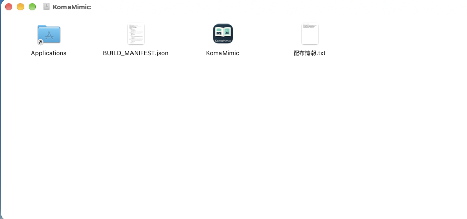
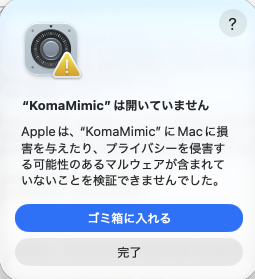
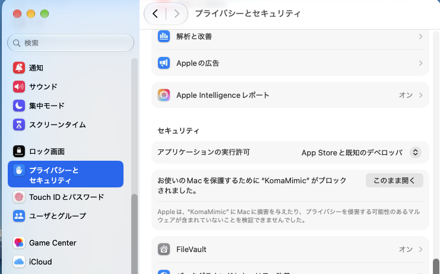
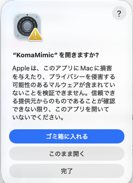
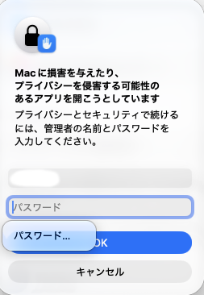

# インストール

日本語 | [English](../en/user/install.md)

## Windows（ZIP版）

Windows版はx86_64（64bit Intel/AMD）向けのZIP版です。
同梱するQt 6.11の対応範囲はWindows 10（1809以降）・Windows 11です
（[Qtの対応表](https://doc.qt.io/qt-6.11/supported-platforms.html#windows)）。
Qtなどの主要ライブラリを同梱しており、Qt SDK・Visual Studio・vcpkgの導入は不要です。

### 必要なランタイム

**Microsoft Visual C++ v14 x64 再頒布可能パッケージ**が必要です。
未導入・古い場合は、Microsoftの[公式ダウンロード案内](https://learn.microsoft.com/en-us/cpp/windows/latest-supported-vc-redist)
から最新のX64版を取得し、画面の案内に従ってインストールしてください。
アプリのZIPにこのランタイムは含めていません。

`VCRUNTIME140.dll`や`MSVCP140.dll`が見つからないというエラーが出る場合も、
このランタイムの導入・更新を確認してください。

### 入手とチェックサム

[GitHubのReleases](https://github.com/asfdrwe/KomaMimic/releases)から
`KomaMimic-1.0.0-windows-x86_64.zip`を取得します。以下はv1.0.0のファイル名の例です。
別の版を使う場合は、取得した名前に置き換えてください。

#### 配布物の検査
配布物の検査をしたい場合は、配布用ZIPと`SHA256SUMS`があるフォルダーでPowerShellを開き、次を実行します。

```powershell
Get-FileHash -LiteralPath .\KomaMimic-1.0.0-windows-x86_64.zip -Algorithm SHA256
```

表示された`Hash`を、`SHA256SUMS`にある同じZIP名の行の先頭64文字と照合してください。
英字の大文字・小文字の違いは無視できます。

### 展開と起動

配布用の`KomaMimic-1.0.0-windows-x86_64.zip`を右クリックし、**すべて展開**を選びます。
展開した`KomaMimic-1.0.0-windows-x86_64`フォルダーを、書込み可能な好きな場所へ置きます。
例えば、エクスプローラーで`%LOCALAPPDATA%`を開き、`Programs`フォルダー（なければ作成）の
中へ置けば、起動ファイルは次の場所になります。

```text
%LOCALAPPDATA%\Programs\KomaMimic-1.0.0-windows-x86_64\komamimic.exe
```

`komamimic.exe`をダブルクリックして起動します。
同じフォルダーのworker・DLL・サブフォルダーも必要なので、一式を保持してください。
ZIP内から直接起動せず、展開したフォルダーから起動します。
ショートカットを作る場合は、この`komamimic.exe`を参照先にします。
起動後の操作は[基本操作](basic.md)を参照してください。

### 更新

1. KomaMimicを終了し、[設定フォルダーをバックアップ](settings.md)します。
2. 新しい版の配布用ZIPを取得し、チェックサムを確認します。
3. 新しい別フォルダーへ一式を展開し、その中の`komamimic.exe`で起動します。
4. ショートカットを使っている場合は、新しい版のexeを参照するよう変更します。
5. 動作を確認した後、不要になった古い版の展開フォルダーを削除します。

通常の設定・本棚・履歴は実行ファイルとは別の場所へ保存するため、同じユーザーで起動すれば引き継ぎます。
`--config`で別の設定を指定して使っていた場合は、更新後も同じ設定ファイルを指定してください。

### 削除

KomaMimicを終了し、展開したフォルダーと、自分で作成したショートカットを削除します。
設定・本棚・履歴・キャッシュは残ります。

これらも削除したい場合は、[保存場所](settings.md)を確認し、必要なデータをバックアップしてから
該当フォルダーを削除してください。本棚・履歴・読書状態も失われます。
通常の設定フォルダーは`%LOCALAPPDATA%\KomaMimic\KomaMimic`です。
読んでいた画像や書庫などの作品ファイルは、アプリの削除とは別です。
Visual C++ランタイムは他のアプリも使うため、KomaMimicの削除に伴って削除する必要はありません。

## macOS（DMG版）

macOS版はApple Silicon（arm64）のMac向けで、macOS 15以降が必要です。
Qtなどの主要ライブラリを同梱しているため、HomebrewやQt SDKの導入は不要です。
Developer ID署名とAppleによる公証は行っていないため、初回起動時は以下の許可操作が必要です。

### 入手とチェックサム

[GitHubのReleases](https://github.com/asfdrwe/KomaMimic/releases)から
`KomaMimic-1.0.0-macos-arm64.dmg`を取得します。以下はv1.0.0のファイル名の例です。
別の版を使う場合は、取得した名前に置き換えてください。

チェックサムを確認する場合は、DMGがあるフォルダーでターミナルを開き、次を実行します。

```sh
shasum -a 256 KomaMimic-1.0.0-macos-arm64.dmg
```

表示された先頭64文字を、配布する`SHA256SUMS`にある同じDMG名の行と照合してください。

### 配置と起動

1. ダウンロードしたDMGをダブルクリックして開きます。
2. 中の`KomaMimic`を、同じウィンドウの`Applications`へドラッグしてコピーします。
3. コピーが終わったら、Finderの「アプリケーション」を開き、`KomaMimic`をダブルクリックします。




### 初回起動時のGatekeeperの許可

ダウンロードしたDMGからコピーしたアプリは、初回起動時にmacOSのGatekeeperでブロックされます。
次の手順で、このアプリの起動を許可します。画面の文言はmacOSの版により異なる場合があります。

1. 「“KomaMimic”は開いていません」と表示されたら、**完了**を押して一旦閉じます。

    

2. 「システム設定」→「プライバシーとセキュリティ」を開き、下へスクロールします。
    KomaMimicがブロックされたという表示の横にある、**このまま開く**を押します。

    

3. 「“KomaMimic”を開きますか？」という確認でも、**このまま開く**を選びます。

    

4. 管理者の名前とパスワードを求められたら入力し、**OK**を押します。KomaMimicが起動します。

    

これはアプリ単位の許可です。詳しくはAppleの[Macでアプリを安全に開く](https://support.apple.com/ja-jp/102445)を参照してください。
起動後の操作は[基本操作](basic.md)と[macOSで異なる操作](macos.md)を参照してください。

### 更新

1. メニューバーの「KomaMimic」→「終了」、またはCommand+QでKomaMimicを終了します。
2. [設定フォルダーをバックアップ](settings.md)し、新しい版のDMGを取得してチェックサムを確認します。
3. DMGを開き、`KomaMimic.app`をApplicationsへコピーします。同名のアプリがある場合は置き換えます。
4. Finderの「アプリケーション」から起動します。Gatekeeperの確認が出た場合は、上記と同じ手順で許可します。
5. 動作を確認したらDMGを取り出します。不要になったダウンロード済みのDMGは削除できます。

通常の設定・本棚・履歴はアプリ本体とは別に保存されるため、同じユーザーで起動すれば引き継ぎます。
`--config`で別の設定を指定して使っていた場合は、更新後も同じ設定ファイルを指定してください。

### 削除

KomaMimicを終了し、Finderの「アプリケーション」にある`KomaMimic.app`をゴミ箱へ移動します。
Dockへ自分で登録した項目や、不要なダウンロード済みのDMGも削除できます。
設定・本棚・履歴・キャッシュは残ります。

これらも削除したい場合は、[保存場所](settings.md)を確認し、必要なデータをバックアップしてから
該当フォルダーを削除してください。本棚・履歴・読書状態も失われます。
通常の設定フォルダーは`~/Library/Preferences/KomaMimic/KomaMimic`、
サムネイルキャッシュは`~/Library/Caches/KomaMimic/KomaMimic/thumbnails-v1`です。
Finderの「移動」→「フォルダへ移動」で、これらのパスを入力できます。
読んでいた画像や書庫などの作品ファイルは、アプリの削除とは別です。

## Linux（AppImage版）

Linux版はx86_64（amd64）用のAppImageです。Qtなどの主要ライブラリを同梱しているため、
ソースからビルドするための開発用パッケージを追加せずに使えます。AppImageを好きな場所に置いて起動できます。

Ubuntu 22.04相当（glibc 2.35）以降の環境を基準に、自動検査を行っています。Fedora 44でも起動と基本動作を確認しています。

### 入手と展開

[GitHubのReleases](https://github.com/asfdrwe/KomaMimic/releases)で配布するLinux用AppImageを取得します。
`komamimic-linux-x86_64-appimage.zip`をダウンロードし、ZIPを展開してください。

実行するファイルは `KomaMimic-1.0.0-linux-x86_64.AppImage` です。
同じ場所の `sources/` は対応ソースであり、起動のために展開・ビルドする必要はありません。
`komamimic.desktop`と`komamimic.png`は、アプリケーションメニューへ登録するためのファイルです。
以下のファイル名はv1.0.0の例です。別の版を使う場合は取得した名前に置き換えてください。

`SHA256SUMS`が付属している場合は、ZIPを展開したフォルダーで端末を開き、整合性を確認できます。

```sh
sha256sum --check SHA256SUMS
```

### 配置と起動

AppImageを置く場所の例として、ホームフォルダー内の `.local/bin/` を使います。
AppImageがあるフォルダーで端末を開き、次を実行します。

```sh
mkdir -p "$HOME/.local/bin"
mv KomaMimic-1.0.0-linux-x86_64.AppImage "$HOME/.local/bin/"
chmod u+x "$HOME/.local/bin/KomaMimic-1.0.0-linux-x86_64.AppImage"
"$HOME/.local/bin/KomaMimic-1.0.0-linux-x86_64.AppImage"
```

ファイルマネージャーから起動する場合も、先にファイルのプロパティで実行権限を許可します。
その後、AppImageをダブルクリックするか、ファイルマネージャーの「実行」を選びます。
画面の名称やダブルクリック時の動作はデスクトップ環境によって異なります。

起動後の操作は[基本操作](basic.md)を参照してください。

### アプリケーションメニューへの登録（任意）

AppImageを上記の`~/.local/bin/`へ配置した場合は、ZIPに同梱したファイルを次のようにコピーします。
ZIPを展開したフォルダーで実行してください。

```sh
mkdir -p "$HOME/.local/share/applications" "$HOME/.local/share/icons/hicolor/256x256/apps"
cp komamimic.desktop "$HOME/.local/share/applications/"
cp komamimic.png "$HOME/.local/share/icons/hicolor/256x256/apps/"
```

メニューにKomaMimicが表示されます。反映されない場合は、一度ログアウトして入り直してください。
同梱のデスクトップエントリは、その版のAppImageを`~/.local/bin/`から起動します。
別の場所へ置く場合は、`komamimic.desktop`の`Exec=`を実際の配置先に合わせて変更します。
ホームフォルダー名や開くファイル名に空白・日本語があっても、そのまま利用できます。

### FUSEのエラーで起動できない場合

通常起動ではFUSEを使います。`Cannot mount AppImage`、`No suitable fusermount binary`などが
表示される場合は、OSのFUSE設定を確認するか、次の展開実行を使ってください。
端末から起動するとエラー内容を確認できます。

```sh
"$HOME/.local/bin/KomaMimic-1.0.0-linux-x86_64.AppImage" --appimage-extract-and-run
```

この方法はFUSEを使わず、一時フォルダーへ展開して起動します。展開先には十分な空き容量が必要です。
通常起動に比べて起動までに時間がかかることがあります。

展開したファイルを残して繰り返し使いたい場合は、新しい専用フォルダーを作って展開します。

```sh
mkdir "$HOME/.local/bin/KomaMimic-1.0.0-extracted"
cd "$HOME/.local/bin/KomaMimic-1.0.0-extracted"
../KomaMimic-1.0.0-linux-x86_64.AppImage --appimage-extract
./squashfs-root/AppRun
```

以後はこのフォルダー内の `squashfs-root/AppRun` から起動します。
展開した内容を一式保持してください。
FUSEや展開実行については[AppImage公式の説明](https://docs.appimage.org/user-guide/troubleshooting/fuse.html)も参照できます。

### 更新

1. KomaMimicを終了します。
2. 新しい版のAppImageを取得し、付属するチェックサムを確認します。
3. 使いたい場所へ配置し、実行権限を付けて起動します。
4. メニューへ登録している場合は、新しいZIPの`komamimic.desktop`と`komamimic.png`も同じ場所へコピーし直します。
   自作のショートカットを使っている場合は、参照先を更新します。

設定や本棚・履歴はAppImageとは別の場所に保存されるため、同じユーザーで起動すれば引き継ぎます。
更新前に[設定フォルダーをバックアップ](settings.md)しておくと、元の状態を残せます。
新しい版の動作を確認してから、不要になった古いAppImageを削除してください。
手動展開で使っている場合は、新しい版も別フォルダーへ展開して起動します。

### 削除

KomaMimicを終了し、AppImageと、自分で作成したショートカットを削除します。
手動展開した場合は、その版の専用展開フォルダーも削除します。
同梱ファイルでメニューへ登録した場合は、次の2ファイルも削除します。

```sh
rm -f "$HOME/.local/share/applications/komamimic.desktop"
rm -f "$HOME/.local/share/icons/hicolor/256x256/apps/komamimic.png"
```

AppImageを削除しても、設定・本棚・履歴・キャッシュは残ります。
これらも削除したい場合は、[保存場所](settings.md)を確認し、必要なデータをバックアップしてから
該当フォルダーを削除してください。本棚・履歴・読書状態も失われるため、
後から使い直す予定がある場合は設定フォルダーを残します。
読んでいた画像や書庫などの作品ファイルは、アプリの削除とは別です。
