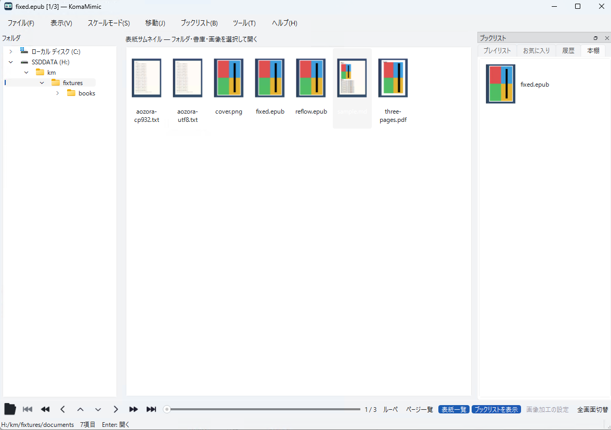

# 本棚・履歴・しおり

日本語 | [English](../en/user/library.md)

「ブックリスト」メニューから履歴・お気に入り・プレイリスト・本棚を利用できます。
最近開いた本や登録した本を一覧から選び直し、保存された位置から読み続けられます。

## 登録と再開

読書中に「ブックリスト」のお気に入り・プレイリスト・本棚への追加を選びます。
表紙や背表紙の登録、リストの詳細・保存・読み込みも同じメニューにあります。
履歴と再開位置の保存は「ブックリスト → 履歴・再開位置の設定…」で調整します。
実際の本を移動・削除すると、以前のパスを指す項目からは開けなくなる場合があります。

現在位置のマーカーと、目次への登録・移動も「ブックリスト」から行います。
文書の目次は書籍が持つ目次と本文位置を使い、画像のページ番号と区別します。

## 並び順と再生

「ツール → ファイルソート」で自然順・名前・種類・サイズ・日時・書庫順などを選べます。
表紙一覧の並び方はフォルダ・表紙一覧の設定で指定します。
「ブックリスト → ページ・プレイリストの再生」で自動再生を操作できます。
これはGIF等のアニメーション画像の再生とは別です。アニメーションの操作は「ツール」にあります。

登録内容・履歴はローカルの読書データです。[保存場所とバックアップ](settings.md)を参照してください。
