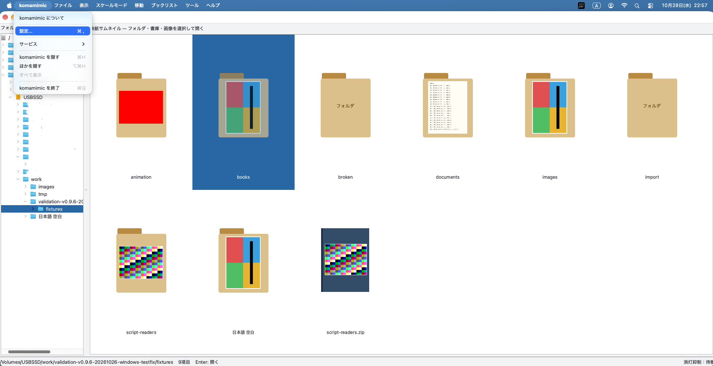
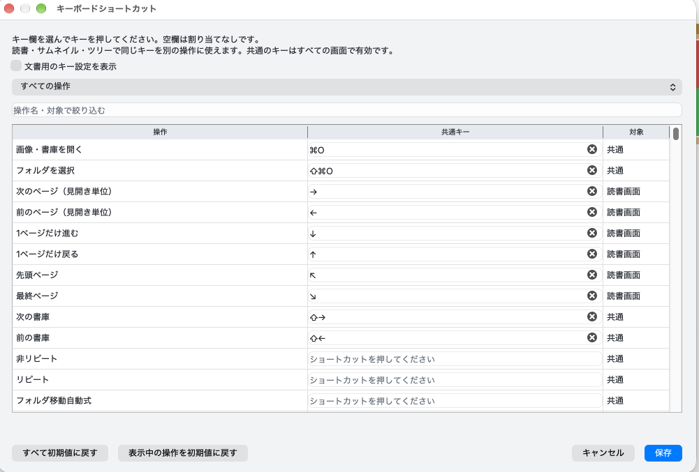

# macOSで異なる操作

日本語 | [English](../en/user/macos.md)

## キーとメニュー

| 操作 | macOSの初期操作 |
|---|---|
| 一覧で選択項目を開く | Return |
| 全画面 | Control+Command+F（⌃⌘F） |
| 環境設定 | Command+,（⌘,） |

メニューはmacOSの画面上部に表示します。環境設定・終了などはアプリの標準メニューに入ります。
Windows/Linuxの説明のCtrlが、macOSではCommandとして表示・動作する操作があります。
一律に読み替えず、メニューとショートカット設定に表示される割当を確認してください。

## 入力機器と電源

右クリック等はMacで設定した副ボタン操作を使います。マウスの割当は操作設定で変更できます。
読書中の自動消灯抑制は環境設定で有効にし、前面の読書画面で動作します。
対象は自動消灯で、すべてのスリープ条件を止める機能ではありません。
