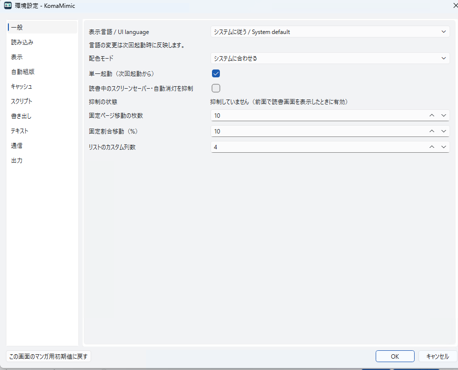
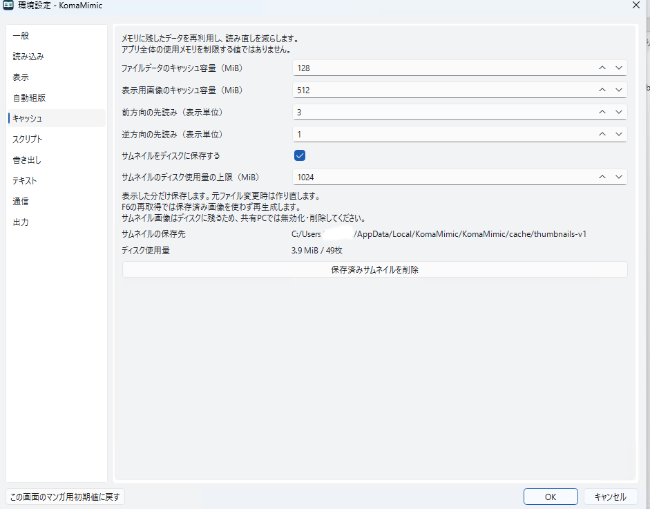

# 設定・読書データ・キャッシュ

日本語 | [English](../en/user/settings.md)

## 設定と読書データ

通常起動ではOS標準の設定場所に `settings.ini` を保存します。
同じフォルダの `library.sqlite3` に本棚・履歴・読書状態などを保存します。

| OS | 通常の設定ファイル |
|---|---|
| Windows | `%LOCALAPPDATA%\KomaMimic\KomaMimic\settings.ini` |
| macOS | `~/Library/Preferences/KomaMimic/KomaMimic/settings.ini` |
| Linux | `~/.config/KomaMimic/KomaMimic/settings.ini` |

Linuxの `XDG_CONFIG_HOME` を指定している場合は `~/.config` の部分が変わります。
コマンドラインの `--config /path/to/settings.ini` で別の設定を指定できます。
旧配置を使っていた場合は、起動時の移行によって場所が変わる場合があります。

バックアップはアプリを終了して設定フォルダごとコピーします。

## 全画面表示

「環境設定 → 表示 → 全画面表示」で切り替え、OKを押すと現在のウィンドウに反映します。
キャンセルした場合は変更しません。メニューやショートカット、OSの操作による切り替えも記憶します。
全画面で終了すると次回も全画面で起動し、通常表示に戻して終了すると次回は通常表示になります。
全画面を解除した際は通常ウィンドウの位置・サイズや最大化状態に戻ります。

新規設定や全画面状態を保存していない旧設定では、通常表示で起動します。
`--fullscreen`（`-f`）を指定した場合は保存状態にかかわらず全画面になります。
全画面状態は設定スロットとKomaMimic設定のエクスポート／インポートにも含まれます。
全画面状態の項目がない旧設定を取り込む場合は、現在の表示状態を保ちます。

## キャッシュ

「環境設定 → キャッシュ」でメモリの先読みとサムネイルのディスク保存を設定します。
サムネイルのディスク保存は既定で有効、上限512 MiBです。設定画面から削除できます。
サムネイルは再生成できますが、設定や読書履歴の代わりにはなりません。

| OS | 通常のサムネイルキャッシュ |
|---|---|
| Windows | `%LOCALAPPDATA%\KomaMimic\KomaMimic\cache\thumbnails-v2` |
| macOS | `~/Library/Caches/KomaMimic/KomaMimic/thumbnails-v2` |
| Linux | `~/.cache/KomaMimic/KomaMimic/thumbnails-v2` |

Linuxの `XDG_CACHE_HOME` を指定した場合は `~/.cache` の部分が変わります。
これらはQtの[OS別保存場所](https://doc.qt.io/qt-6/qstandardpaths.html#StandardLocation-enum)を使います。
別の `--config` を指定しても、OS標準のキャッシュ場所は独立しています。
メモリキャッシュの値はアプリ全体の使用メモリ上限ではありません。

### 再利用と再生成

保存済みの正常なサムネイルPNGは、別の処理による保存・整理ロックやキャッシュ全件の一覧走査を待たずに読み込みます。
保存・削除・容量整理には引き続きロックを使用し、PNGと管理情報は一時ファイルから置き換えます。
現在の画面に必要なPNGの確認は、元画像の生成とは別の処理枠で進め、見つかった画像から表示します。
不足した画像は生成後に表示へ渡します。表示の更新とPNG保存には別の処理枠があり、操作が続く間も進めます。画面外になった未完了要求は取り消します。
ページサムネイル表示中は、非表示の読書画像の生成や読書の先読みを行いません。
保存待ちがメモリ上限に達した場合はディスクへ退避し、保存先の競合や書込失敗では再試行します。通常終了時も未保存画像を退避し、次回起動後に保存を再開します。退避分と保存中の一時ファイルには、設定した完成済みキャッシュ容量とは別に空き領域が必要です。ディスク満杯などで退避自体ができない場合や突然の異常終了では、再生成が必要になることがあります。

キャッシュは容量だけを上限とし、超過時は画像の保存日時が古い順に削除します。ファイル数や未使用期間で削除せず、読み出しても保存日時を変えません。
保存済み画像は元ファイルを検査せず、そのまま表示します。利用ごとの検証や定期検証は行いません。取得済み一覧の情報の差分や関係する変更通知があるときだけ、表示を妨げない優先度で更新を確認します。変更がなければ元画像やZIPを読み直しません。
フォルダへの追加後も採用元とその情報が同じなら、画像生成やPNG再保存をしません。既存キャッシュ形式で判定できない深い変更は追跡せず、必要な場合はF6で明示更新できます。
「環境設定 → サムネイル」の「フォルダ表紙の追加探索階層数」は既定0です。A内にBがある場合、0でもB直下の画像・ZIP等を探します。B/Cまでは進まず、1ならC直下まで探します。設定範囲に候補がなければフォルダアイコンを表示します。探索を浅くしても保存済みの表紙は消しません。
フォルダやモードの切替時には旧対象の未完了処理を取り消し、完成画像の保存だけを継続します。読書中は現在表示、次に先読みを優先し、サムネイルの生成・更新検査を行いません。

KomaMimic・Qt・スクリプトのバージョンやスクリプト設定の変更だけでは再生成しません。変更が実際の画像に影響した場合は、サムネイルの再取得またはキャッシュ削除を行ってください。
表示するサムネイルの寸法・間隔等を変えるだけでは全キャッシュを削除しません。
`thumbnails-v2` は従来の `thumbnails-v1` を読み込まず、移行もしません。旧キャッシュを消す場合は、アップデート前に旧版の「環境設定 → キャッシュ」で削除することを推奨します。新版のキャッシュ削除は通常 `thumbnails-v2` のみが対象で、旧 `thumbnails-v1` は自動削除されません。
キャッシュ削除は元画像・書庫・本棚・読書履歴には影響しません。

異常終了時の未完成の一時ファイルは、完成済みPNGとして読みません。残ったロックはQtによる所有プロセス等の判定で回収します。
TXT・Markdownやテキストを含む書庫の表紙等は、フォントや外部画像への依存を避けるためディスク保存の対象外になる場合があります。

### サムネイルが正しく表示されない場合（回避策）

1. 表紙・ページサムネイル一覧を表示し、`F6`（「サムネイルを再取得」）で元ファイルから再生成してください。古い表紙、取り違え、表示されない画像などは、まずこの操作で確認します。
2. 改善しない場合は「環境設定 → キャッシュ」から現在のサムネイルキャッシュを削除し、対象のフォルダや書庫を開き直して再生成してください。
3. それでも改善しなければ、元画像・ZIP等が読み込めること、ディスクの空き容量、ファイルアクセス権限を確認してください。元ファイルの破損はキャッシュ再生成では修復できません。

キャッシュ削除で元画像・書庫・本棚・読書履歴は消えません。再生成には元ファイルの読み込み時間が必要です。

## 配色と言語

環境設定の一般でシステム追従・ライト・ダークと、日本語・English・システム設定を選べます。
UI言語は保存後の再起動で反映します。配色モードは本文や画像の設定色を置き換えません。

詳細は[MangaMeeyaとの違い](compatibility.md)を参照してください。
