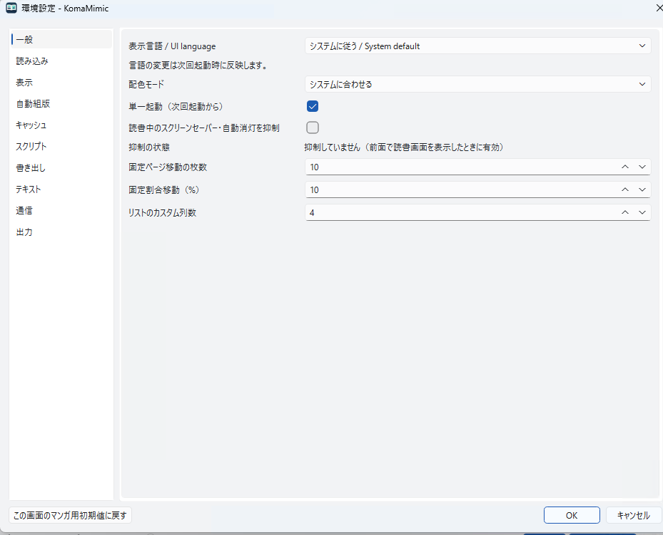
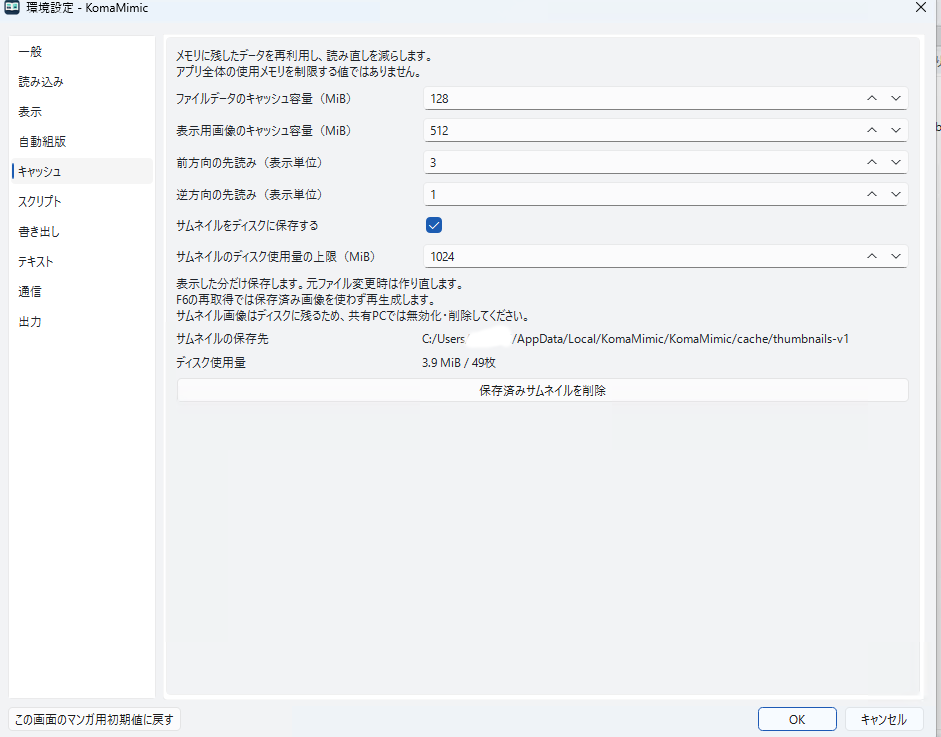

# 設定・読書データ・キャッシュ

日本語 | [English](../en/user/settings.md)

## 設定と読書データ

通常起動ではOS標準の設定場所に `settings.ini` を保存します。
同じフォルダの `library.sqlite3` に本棚・履歴・読書状態などを保存します。

| OS | 通常の設定ファイル |
|---|---|
| Windows | `%LOCALAPPDATA%\KomaMimic\KomaMimic\settings.ini` |
| macOS | `~/Library/Preferences/KomaMimic/KomaMimic/settings.ini` |
| Linux | `~/.config/KomaMimic/KomaMimic/settings.ini` |

Linuxの `XDG_CONFIG_HOME` を指定している場合は `~/.config` の部分が変わります。
コマンドラインの `--config /path/to/settings.ini` で別の設定を指定できます。
旧配置を使っていた場合は、起動時の移行によって場所が変わる場合があります。

バックアップはアプリを終了して設定フォルダごとコピーします。

## キャッシュ

「環境設定 → キャッシュ」でメモリの先読みとサムネイルのディスク保存を設定します。
サムネイルのディスク保存は既定で有効、上限512 MiBです。設定画面から削除できます。
サムネイルは再生成できますが、設定や読書履歴の代わりにはなりません。

| OS | 通常のサムネイルキャッシュ |
|---|---|
| Windows | `%LOCALAPPDATA%\KomaMimic\KomaMimic\cache\thumbnails-v1` |
| macOS | `~/Library/Caches/KomaMimic/KomaMimic/thumbnails-v1` |
| Linux | `~/.cache/KomaMimic/KomaMimic/thumbnails-v1` |

Linuxの `XDG_CACHE_HOME` を指定した場合は `~/.cache` の部分が変わります。
これらはQtの[OS別保存場所](https://doc.qt.io/qt-6/qstandardpaths.html#StandardLocation-enum)を使います。
別の `--config` を指定しても、OS標準のキャッシュ場所は独立しています。
メモリキャッシュの値はアプリ全体の使用メモリ上限ではありません。

## 配色と言語

環境設定の一般でシステム追従・ライト・ダークと、日本語・English・システム設定を選べます。
UI言語は保存後の再起動で反映します。配色モードは本文や画像の設定色を置き換えません。

詳細は[MangaMeeyaとの違い](compatibility.md)を参照してください。
