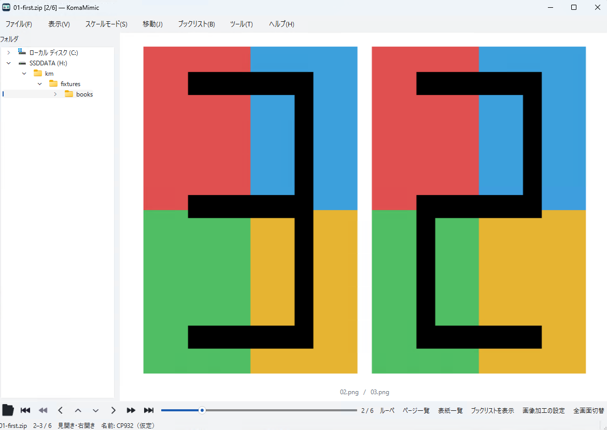

# 表示と画像加工

日本語 | [English](../en/user/views.md)

## 見開きと倍率

表示メニューで単ページ・見開きを選びます。新規設定は右開き・見開き・表紙単ページが有効です。
`Space` は画像の自動見開きを切り替えます。明示的な単ページ／見開きの選択とは区別します。
開く向きはバックスラッシュ（JISキーボードの¥）で切り替えられます。

`X` は画面に合わせる、`C` は原寸、テンキーの+/-は拡大・縮小です。
「スケールモード」で倍率の合わせ方と補間方式を選べます。

## メニューと読書バー

読書用の下部バーは初期状態で非表示です。「表示 → ツールバー表示」または
「環境設定 → 表示」で有効にします。全画面では上端からメニュー、下端から有効な読書バーを
呼び出せます。固定・自動・非表示は環境設定で選びます。
下部バーの左右の操作群と中央のページバーは「操作設定 → ツールバー」で編集します。

## 加工と保存

「ツール → 画像加工」で回転・切抜き・グレースケール・色調などを設定します。
初期状態では加工はオフで、`F` または加工プロファイルの選択で有効にします。
スクリプトfilterはnative加工の後に適用します。

通常の表示加工とページの論理編集は元の画像・書庫を直接変更しません。
結果を残すには保存・書出しを使います。実ファイルの改名やごみ箱への移動は別の操作です。
クリップボードから作った本も、必要なら終了前に書き出してください。
PDF出力はラスタ画像となり、元PDFの文字検索情報やリンクは残りません。
文書ビューには画像加工・ページ編集・画像としての書出し・印刷を適用しません。
